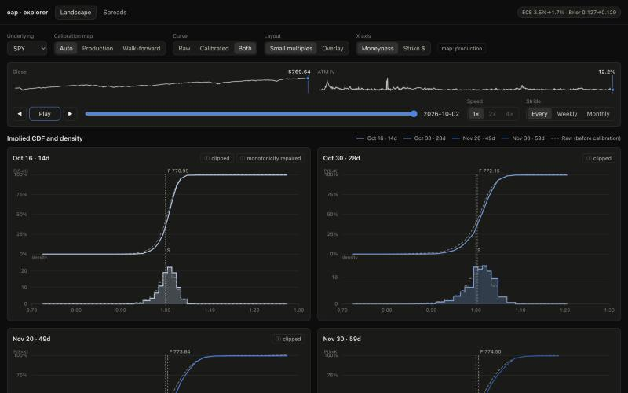
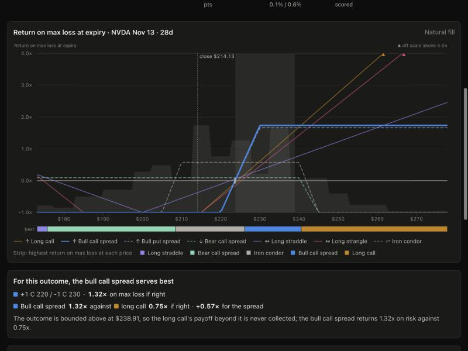

# options-analytics-platform

A data platform that turns free options-chain history into a ranked list of put credit spreads, ordered by expected return on max loss. Chains and daily prices land in Apache Iceberg tables, dbt builds silver and gold tables on DuckDB, and a walk-forward backtest checks the market-implied probabilities against what happened since 2020 before it scores the latest session's spreads. The project exists to build that path end to end, from vendor data to a ranked decision, with a quality gate between every layer.

```
DoltHub chains ─┐
DoltHub prices ─┼─> Airflow ─> Iceberg bronze ─> dbt silver, gold ─> analytics models ─> report
Alpaca daily ···┘   DAGs       option_chain      on DuckDB           calibration,        results.md
 (needs a key)                 underlying_price  (tests = gate 2)    spread scores       + figures
                                   └─ Great Expectations = gate 1 (daily chain snapshot)
Datasets chain the DAGs: bronze update -> dbt_build -> gold update -> score_spreads
```

**Status: Phases 0-3 are built and verified locally; the cloud targets are configured, not provisioned.** The local path (DuckDB, a file-based Iceberg catalog, Airflow in Docker Compose) runs end to end on the full DoltHub history. No Snowflake, AWS or Alpaca account exists yet, so Snowflake, S3 with Glue and the Alpaca snapshot are compile-checked or unit-tested configuration, and nothing has run on them.

## Daily use

The `nightly` GitHub Actions workflow refreshes the data at 06:30 UTC, Tuesday to Saturday: it pulls the previous session from DoltHub (public data, no account needed), builds gold and publishes the DuckDB file as an artifact. On the laptop:

```bash
make daily    # download the latest nightly gold file (needs gh); prints its latest session
make serve    # the explorer on http://127.0.0.1:8000 (stop it before the next make daily)
```

Then open http://127.0.0.1:8000. Each tab answers one question:

- **Structures**: which option structure serves the outcome you expect for the price at expiry, per ticker, or for every ticker at once on the outcome map.
- **Spreads**: the Top 10 put credit spreads to enter under the tested rule (45 to 69 days to expiry, short strike 95% to below 100% of the close, ranked by the shrunk-POP return; [docs/rule-lab.md](docs/rule-lab.md) has how it tested), plus every scored spread.
- **Landscape**: the implied distribution of the price at expiry, raw and calibrated, for any ticker and session.

Every number is a historical measurement, not trade advice. The local Airflow stack below is for backfills and the showcase; daily use does not need it.

## Quickstart

Needs Python 3.12, [uv](https://docs.astral.sh/uv/) and Docker (Colima works on macOS).

```bash
uv sync --all-groups                 # install dev, airflow, dbt and report dependency groups
make check                           # lock check, lint, mypy --strict, tests, dbt on synthetic data
cp .env.example .env                 # defaults work locally
make airflow-build && make up        # Airflow UI at http://localhost:8080 (airflow / airflow)
for d in backfill_prices dbt_build score_spreads; do docker compose exec -T airflow-scheduler airflow dags unpause $d; done
make backfill START=2020-01-01 END=2026-10-02    # chains: about an hour
docker compose exec -T airflow-scheduler airflow dags trigger backfill_prices \
  --conf '{"start": "2020-01-01", "end": "2026-10-02"}'    # prices: no make target
make report                          # after score_spreads finishes: docs/results.md and docs/img/
```

`dbt_build` and `score_spreads` start on Dataset updates, so there is nothing to trigger. `dbt_build` fails until both bronze tables exist and runs again on the next update. `make check` needs no credentials or data. The daily Alpaca snapshot needs `ALPACA_API_KEY` and `ALPACA_SECRET_KEY` in `.env`. Operating instructions are in [docs/runbook.md](docs/runbook.md).

## Results

<!-- results:start -->
| Out-of-sample metric | Risk-neutral | Calibrated | Change |
| --- | ---: | ---: | ---: |
| Brier score | 0.1263 | 0.1288 | +0.0025 |
| Log loss (nats) | 0.3908 | 0.3951 | +0.0042 |
| Expected calibration error | 0.0350 | 0.0165 | -0.0186 |

| Rank | Underlying | Session | Expiration | DTE | Short/long | Mid credit | Natural credit | POP calibrated | POP risk-neutral | Expected return on max loss |
| --- | ---: | ---: | ---: | ---: | ---: | ---: | ---: | ---: | ---: | ---: |
<!-- results:end -->


Spreads are ranked by calibrated annualised return on max loss. The collateral held for a cash-secured put credit spread equals its max loss, so this is the return on collateral under its other name; the code keeps the identifiers `expected_roc` and `annualised_roc`. [docs/results.md](docs/results.md) has the coverage, exclusions, metrics by segment, the top spreads and the caveats. To read the reliability diagram, compare each series with the dashed diagonal: a point on it means events of that predicted probability happened that often. The calibrated series should lie closer to the diagonal than the risk-neutral one on out-of-sample years (2021 onward), and the lower panel shows how many predictions each bin holds.

Each spread also carries a fair credit (the expected payout of the long put spread under the calibrated distribution), the edge (the mid credit minus it, also as a share of the mid credit), the standard deviation of its payoff, a per-trade reward to risk, and a price-implied probability of profit and its gap to the calibrated one. Three further ranks use them: by edge, by reward to risk, and a "Top to enter" ranking that applies every guard (calibrated POP, a minimum credit, a positive edge at the natural credit, no tail flags), keeps 45 to 69 days to expiry and a short strike from 95% to below 100% of the close, and orders by the annualised return at the natural credit with the calibrated POP shrunk halfway toward the price-implied one (the rule lab's pick since 2026-10-20, [ADR 0015](docs/decisions/0015-entry-rule-from-the-rule-lab.md); before, it ordered every guarded spread by annualised return on max loss). The edge is the historical variance risk premium applied to one chain, not a contract-specific mispricing, and it is largest in the far tail where the calibration map rests on the fewest events; the rankings describe a historical calibration, not trade advice. [ADR 0013](docs/decisions/0013-edge-and-risk-adjusted-ranking.md) has the definitions and the evidence.

Two documents measure whether that ranking selects well. [docs/backtest-entry-rule.md](docs/backtest-entry-rule.md) is a backtest of the "Top to enter" rule from 2021 to 2026 out of sample, filled at the natural credit and held to expiry: the previous rule won 64.1% of 10,458 trades against a predicted 73.0% and returned -2.0% on capital at risk; the current rule won 76.2% of 9,842 trades against 77.5% predicted, with a mean of +10.3% per trade but -3.05% in total on capital at risk, because a few large-dollar losses (2022, AMZN, GOOGL) outweigh the per-trade average. [docs/rule-lab.md](docs/rule-lab.md) is the rule lab (`scripts/rule_lab.py`): every eligible spread is scored once with the walk-forward map of its year, then 1,600 selection rules (ranking, days to expiry, short-strike moneyness, regime gate, one spread per underlying, natural-edge margin) are chosen on 2021-2024 and reported on a 2025-2026 hold-out that no choice looked at. The rules that held up sell 45 to 69 day spreads with the short strike near the close and rank on the natural credit; the one the product now uses returned 7.5% per trade and 3.0% on capital at risk on the hold-out against the previous rule's -1.8% and -2.1%, with an interval that still includes zero. Both are measurements of a selection rule, not trade advice.

[docs/regime-calibration.md](docs/regime-calibration.md) and [docs/growth-lab.md](docs/growth-lab.md) are the growth lab (`scripts/regime_calibration.py`, `scripts/growth_lab.py`): one calibration map per regime scored worse out of sample than the pooled map, so every long call and put was scored at the ask under the pooled map with its growth-optimal fraction of capital, and of 25,920 selection and sizing rules chosen on 2021-2024 the best held 45 to 69 day calls struck above the close in calm regimes and returned 37.1% per trade on premium on the 2025-2026 hold-out, with an interval that includes zero and a universe of today's large caps that favours calls.

## Explorer

A local web app over the same gold tables. It shows what the options market implies and how the calibration changes it, and it lets you filter and inspect the ranked spreads.



- **Landscape** (`/landscape`): for one underlying and session, the risk-neutral CDF and density of each expiration (raw and calibrated), a heatmap of P(S < K) over strikes 80% to 120% of the close, the volatility smile and the option chain. A scrubber moves through every session; play animates it. The calibration map is `auto` by default (the production map for the latest session, the walk-forward map of that year for history), and a chip says when a map was fitted on outcomes that settle after the session.
- **Spreads** (`/spreads`): the scored put credit spreads of the latest session, as a scatter of calibrated probability of profit against expected return on max loss, a sortable table, and for one spread its payoff and the calibrated density behind it. Eligible spreads only by default.

```bash
make app      # API on http://127.0.0.1:8000 and Vite on http://localhost:5173, with reload
make serve    # one process: the built web app and the API on http://127.0.0.1:8000
make pull-gold  # replace .dbt-local/oap.duckdb with the gold file of the latest nightly run (needs gh; stop make serve first)
```

The API (`src/oap/api/`, FastAPI) reads `.dbt-local/oap.duckdb` read-only and serves from memory, so it does not block the dbt writer except for a moment on each load. It binds `127.0.0.1` only: the data is derived from vendor quotes that are for personal analysis (see Data). Pause playback while `make dbt-build-local` runs. If the file is locked the API answers `503` with `Retry-After`, or serves what it already holds with `X-OAP-Data-Stale: 1`; see the runbook. The web app is `apps/web/` (React, TypeScript and visx), and its types are generated from the API's OpenAPI document. [ADR 0011](docs/decisions/0011-explorer-react-fastapi.md) records the design and [docs/design/explorer-v1.md](docs/design/explorer-v1.md) holds the full spec. `docs/img/explorer.png` and `docs/img/structures.png` are the hand-captured images in `docs/img/`.

### Structures

Given the outcome a reader expects for the price at expiry, the structure calculator measures which option structure serves it best, and when a spread beats an outright call or put. It scores every long call and put, vertical spread, long straddle and strangle and iron condor that one expiration's quotes allow, at natural or mid fills, under the calibrated distribution with its tails completed by lognormals beyond the quoted strikes ([ADR 0014](docs/decisions/0014-structures-tail-completed-distribution.md)). The comparison metric is the return on max loss if the outcome happens. Outcomes are six quantile presets (up, up moderately, flat, down moderately, down, big move) or a custom range in percent of the close. A verdict sentence compares the best spread with the best single, and every number is a measurement, not trade advice. [docs/design/structures.md](docs/design/structures.md) holds the spec.



- **Structures** (`/structures`): one ticker, session and expiration against one outcome: the payoff of the best structure of each kind per dollar of max loss over the calibrated density, a strip showing which kind pays the most at each terminal price, the verdict, and the table of kinds and qualifying structures. API: `GET /api/structures/{symbol}/{session}`.
- **Outcome map** (`/outcomes`): every ticker of a session against the six preset outcomes, with the best kind per cell and how much the best spread beats or trails the best single. API: `GET /api/structures/map`.

## Highlights

- **Medallion on Iceberg.** Two bronze tables hold 1,811,734 option rows and 18,190 price rows for 11 underlyings over 1,194 trading days (2020-01-06 to 2026-10-02). Every write replaces its (trade_date, source) slice and skips unchanged content, so a re-run commits nothing and adds no snapshot.
- **dbt silver and gold.** 17 models (5 silver, 5 gold, 7 analytics) with 129 schema tests and 8 singular tests. Models read Iceberg through DuckDB with an `on-run-start` hook that pins one table version per run; an incremental gold fact is guarded by a row-count and checksum drift gate.
- **Pure numpy options engine.** Black-Scholes, vectorised implied volatility, a risk-neutral CDF from vertical spreads and spread scoring on expected return on max loss, with no scipy and units in every docstring. `hypothesis` property tests include recovering a known lognormal from synthetic chains.
- **Walk-forward calibration with leakage gates.** A yearly isotonic map is fitted only on expirations before 1 January of the year it scores; a singular test checks that in SQL. Metrics carry a cluster-bootstrap interval over expiration dates, and six exclusion rules count what they drop.
- **Airflow 2.11 orchestration.** Eight DAGs chained by Datasets (bronze, `dbt_build`, `score_spreads`), one-slot pools for the two single-writer stores, and fail-fast on errors a retry cannot fix. The daily gate runs before the write, so a failed gate publishes nothing. The full backfills ran through Airflow with no task failures on the final runs.
- **Lock-based image policy.** The Airflow image installs from `uv.lock` and a `pip check` gate; `make lock-check` fails when the exported requirements drift from the lock.
- **Backtest and rule lab.** The first published entry rule was backtested out of sample at the natural fill (it lost money, and the report said so), and 1,600 alternative selection rules were swept with a dev and hold-out split, so the report quotes hold-out figures and counts how many rules beat the baseline by chance. The product now ranks with the rule that held up on the hold-out, prints that rule and its hold-out evidence, and the lab checks that its baseline reproduces the live selection (ADR 0015).
- **Quality bar.** 1,271 tests including the property tests, `mypy --strict`, `ruff`, `detect-secrets` in pre-commit, and CI jobs (`check`, `infra`, `web`) that are green on `main`; the `infra` job builds the Airflow image.

## Data

Bronze is two Iceberg tables, both partitioned by `day(trade_date)` and `source`. Three feeds write to them.

| Source | Table and tag | Provides | Lacks |
| --- | --- | --- | --- |
| [DoltHub](https://www.dolthub.com/repositories/post-no-preference/options) `post-no-preference/options`. Free, no auth, SQL API. | `bronze.option_chain`, `dolthub` | History. Bid, ask, implied volatility, delta, gamma, theta, vega, rho. About 150 rows per symbol per day across 3 to 4 expirations. Coverage runs from 2020-01-06 to 2026-10-02, with about 70% of sessions present. | Last price, volume, open interest and underlying price; stored as nulls. |
| [DoltHub](https://www.dolthub.com/repositories/post-no-preference/stocks) `post-no-preference/stocks`, table `ohlcv`. Same API. | `bronze.underlying_price`, `dolthub_stocks` | Daily open, high, low, close and volume for each watchlist symbol. | Split and dividend adjustment, by design (below). |
| Alpaca options snapshots, `feed=indicative`. Free tier, API key. | `bronze.option_chain`, `alpaca_indicative` | Daily snapshots after the NYSE close: bid, ask, last, volume, greeks, implied volatility, underlying price. Built and unit-tested; no key exists, so no snapshot has been taken. | Open interest (null). Indicative quotes are derived from OPRA and are not the real NBBO, so spreads can be wider or narrower than a fill. |

Loaded today: 1,811,734 chain rows over 1,194 trading days, and 18,190 price rows over 1,697 sessions (2020-01-02 to 2026-10-02). Chain days per underlying run from 822 (META, whose chains start in July 2022) to 1,191 (AAPL).

The watchlist (`dbt/seeds/watchlist.csv`) has 11 symbols: SPY, DIA, XLF, AAPL, MSFT, NVDA, AMZN, GOOGL, META, TSLA and AMD. QQQ and IWM were replaced by DIA and XLF because DoltHub has no options history for them.

**Prices are as traded.** Closes are not adjusted for splits or dividends: AAPL closed at 499.23 on 2020-08-28 and 129.04 on 2020-08-31. That is the price option strikes are quoted against, which is what moneyness and expiration outcomes need. The `split` table is not applied, so `fct_underlying_daily` returns are wrong across split days (a warn-level test lists them), the strike-range test `assert_close_within_strike_range` guards the unit, and the backtest excludes any snapshot whose window holds a move beyond 0.4 in log terms ([ADR 0007](docs/decisions/0007-unadjusted-underlying-prices.md)).

**Price caveats.** DoltHub publishes session D at about 05:30 UTC on D+1, so `daily_prices` lags one session and re-fetches the last five. The `open` column is not range-checked, because the feed holds a row with an open above its high. Before 2022-06-09 the `META` ticker in this database is a different security (the Roundhill Metaverse ETF) and the FB history is not loaded; the loaded META chains start on 2022-07-01, so they never meet those rows, and the backtest drops quotes before that date.

Both sources are for personal analysis only; their terms do not allow redistribution. For that reason no raw data is ever committed: the local Iceberg warehouse (`.iceberg-local/`), `.dbt-local/` and `data/` are gitignored, and API keys live in `.env`, which is gitignored too. Vendor implied volatility and greeks are kept as received ([ADR 0004](docs/decisions/0004-keep-source-greeks.md)).

**Nightly refresh.** The GitHub Actions workflow `nightly` runs at 06:30 UTC, Tuesday to Saturday. It refreshes both bronze tables from DoltHub with `scripts/refresh_bronze.py` (the last 10 sessions on a warehouse kept in the Actions cache, the whole history when the cache is empty), builds silver, gold and the analytics, commits the regenerated `docs/results.md`, the two figures and the results excerpt above, and uploads the gold DuckDB file as an artifact kept 14 days. The warehouse and the DuckDB file never enter git. An artifact of a public repository can be downloaded by anyone with read access, and the vendor terms allow personal analysis only, so the artifact is a way to move the file to my own machine, not a distribution. The workflow is written and linted but has not run on GitHub yet. The local Airflow stack stays the reference pipeline, and the two can differ by a day ([ADR 0012](docs/decisions/0012-nightly-cloud-refresh.md), [runbook](docs/runbook.md)).

## Repo layout

| Path | Contents |
| --- | --- |
| `src/oap/` | The Python package. `calendar.py`: NYSE trading days and half days. `ingest/`: the DoltHub (`dolthub`, `dolthub_stocks`) and Alpaca clients, the bronze contracts (`schema`, `price_schema`), `tables` (one `TableSpec` per bronze table), the Iceberg writer, `merge` and the local catalog. `quality/`: the bronze Great Expectations suite. `engine/`: pure numpy functions: `conventions`, `black_scholes`, `implied_distribution`, `calibration`, `spread_scoring`, `positions` (structures and the tail-completed distribution), `structures` (enumeration and the verdict). `analytics/`: the calibration backtest and spread scoring over gold frames (`config`, `sample`, `backtest`, `scoring`, `views`, `io`), pure apart from `io`. `api/`: the explorer's FastAPI service (`db`, `store`, `landscape`, `spreads`, `structures`, `models`, `routers/`); only `db` and `store` touch the database. |
| `apps/web/` | The explorer web app: Vite, React, TypeScript and visx. `openapi.json` is generated from the API by `make api-schema` and the types in `src/api/schema.ts` are generated from it. `make web-check` runs its lint, format, typecheck, tests, schema drift check and build. |
| `tests/` | pytest and hypothesis tests for the package, the DAGs, the scripts and the dbt project, in paths that mirror the code, with `tests/api/` for the explorer API. 1,393 in all. |
| `dags/` | Airflow DAGs: `backfill_chains`, `daily_chain_snapshot`, `backfill_prices`, `daily_prices`, `iceberg_maintenance`, `dbt_build`, `score_spreads` and `smoke`. Shared code: `common.py` (defaults, the `bronze_writers` pool name, `fail_fast`), `datasets.py` (bronze, `GOLD` and `GOLD_ANALYTICS` Datasets), `dbt_runner.py` (the dbt and report commands, the `duckdb_writer` pool name) and `timetables.py`. |
| `plugins/` | Airflow plugins. `oap_timetables.py` registers `NYSECloseTimetable`, which schedules the daily DAGs at 16:30 America/New_York on NYSE trading days only. |
| `dbt/` | dbt project `oap`. The watchlist seed; `models/staging` and `models/intermediate` (silver, views and one table); `models/marts` (gold: two dimensions and three facts, one incremental); `models/analytics` (seven Python models over `oap.analytics`, DuckDB only); `macros/register_bronze.sql`, which pins the Iceberg snapshot dbt reads; singular tests in `tests/`; and `profiles.yml` with a DuckDB `dev` and a Snowflake `prod` target. |
| `scripts/` | `iceberg_count.py` (`make iceberg-count`), `make_synthetic_bronze.py` (the catalog `make dbt-build` runs on), `make_report.py` (`make report`: results markdown, two figures and the README excerpt), `image_requirements.py` (picks the lock pins the Airflow image installs) and `export_openapi.py` (`make api-schema`: the API's OpenAPI document). |
| `infra/` | Terraform for the S3 bucket, Glue catalog database and a scoped IAM user. Validated, never applied. |
| `docker/` | `airflow.Dockerfile` (official Airflow image, dependencies installed from `uv.lock`, a separate dbt virtualenv; tagged `oap-airflow:dev`), the generated `requirements.txt` and `requirements-dbt.txt` it installs from (`make lock-export`), and the Dockerfile for the on-demand dbt container. |
| `docs/` | Architecture notes, the operator runbook, decision records, the explorer design spec in `design/`, and the generated `results.md` with `img/calibration.png` and `img/spread_scores.png` (written by `make report`). `img/explorer.png` and `img/structures.png` are hand-captured. |
| `.github/workflows/` | CI: the `check` job (`make check`, then `pre-commit`), the `web` job (`npm run check` and the build of `apps/web`) and the `infra` job (Terraform and Compose validation, and the dbt and Airflow image builds). |
| `.claude/` | Claude Code hooks, slash commands and agents for working in this repo. |

## Checks

`make check` runs every check below except `make web-check` and must pass before every commit. It needs no credentials and no vendor data. CI runs the same target (with the deterministic `ci` hypothesis profile) and then `pre-commit` over every file.

| Check | What it guards |
| --- | --- |
| `make lock-check` | `docker/requirements.txt` and `docker/requirements-dbt.txt` match `uv.lock`, so the Airflow image installs the versions CI tested. Fix: `make lock-export`. |
| `make lint` | `ruff` lint and format check: style drift and common bugs. |
| `make typecheck` | `mypy --strict` on `src/`, `tests/`, `dags/`, `plugins/` and `scripts/`: untyped or wrongly typed code, which matters most in the engine. |
| `make test` | `pytest`: package, DAG, script and dbt-project conventions, plus the `hypothesis` property tests of the engine. |
| `make dbt-compile` | `dbt compile` on DuckDB: Jinja, refs and YAML in every model. |
| `make dbt-build` | `make synthetic-bronze`, then `dbt build` on that synthetic Iceberg catalog in three passes: everything, the incremental model again, and the incremental model after two slices are rewritten the way a vendor correction rewrites them (a gold fact that missed the rewrite fails `assert_fct_option_quote_matches_silver`). It runs the real bronze read path, every model, including the analytics, and every test, then renders the report from the synthetic gold schema. It does not prove the SQL on Snowflake (ADR 0002). |
| `make web-check` | The web app: lint, format, typecheck, Vitest, a drift check of the generated API types against `apps/web/openapi.json`, then the production build. Not part of `make check`, which stays Python-only; CI runs it as the `web` job, and `tests/api/test_openapi.py` (in `make check`) fails when `openapi.json` is out of date with the API (fix: `make api-schema`). |

Outside `make check`: `make dbt-build-local` builds silver, gold and the analytics from the real local bronze tables into `.dbt-local/oap.duckdb`, and `make report` renders `docs/results.md` from that file (stop `dbt_build` and `score_spreads` first; only one process may write the file). `make api-schema` regenerates `apps/web/openapi.json` and the web types after an API model changes. `make tf-fmt`, `make tf-validate` and `make compose-config` check the Terraform and Compose files and run in the CI `infra` job. `pre-commit` (install once with `uv run pre-commit install`) runs `detect-secrets`, ruff and file hygiene hooks on each commit.

## Roadmap

| Phase | Scope | State |
| --- | --- | --- |
| 0 | Scaffolding: tooling, CI, Airflow stack, dbt skeleton, Terraform. | Done |
| 1 | Ingest DoltHub history, DoltHub daily prices and daily Alpaca snapshots into Iceberg bronze, with a quality gate. | Done. Chains and prices are fully backfilled; the Alpaca snapshot waits for a key. |
| 2 | dbt silver and gold models with tests as the silver-to-gold gate, scheduled from the bronze Datasets. | Done on DuckDB. Snowflake is not provisioned and no model has run on it. |
| 3 | Spread engine: implied distribution, walk-forward calibration against 2020+ outcomes, expected return on max loss, report. | Done on DuckDB, as dbt Python models over `oap.analytics`, scheduled from the gold Dataset. |
| 4 | A per-date risk-free rate from FRED DTB3 in bronze, and the analytics models as Snowpark Python models. | Not started. The constant 4.5% APY and DuckDB-only models stay until then. |

Provisioning the cloud accounts (AWS for S3 and Glue, Snowflake, Alpaca) is not scheduled. Intraday streaming (a Redpanda service is stubbed out, commented, in `docker-compose.yml`) has no phase yet.

## Why these choices

- [0001: Medallion layering with Iceberg bronze on S3](docs/decisions/0001-medallion-on-iceberg.md). Raw history stays replayable and schema-flexible outside the warehouse.
- [0002: DuckDB as the local and CI dbt target](docs/decisions/0002-duckdb-for-local-dbt.md). `make check` works on a fresh clone with no credentials.
- [0003: Overwrite the (trade_date, source) slice on every bronze write](docs/decisions/0003-partition-overwrite-for-idempotency.md). Backfills and re-runs are idempotent; the daily gate runs before the write.
- [0004: Keep vendor implied volatility and greeks in bronze](docs/decisions/0004-keep-source-greeks.md). Bronze is as received, and the vendor values check our own model later.
- [0005: A standard-library SQLite catalog for local Iceberg](docs/decisions/0005-stdlib-sqlite-local-catalog.md). Airflow 2.11 and pyiceberg's `SqlCatalog` cannot share SQLAlchemy.
- [0006: Install the Airflow image's dependencies from the lock](docs/decisions/0006-image-dependencies-from-the-lock.md). The image runs the versions CI tested, without moving Airflow's own pins.
- [0007: Store underlying prices as traded](docs/decisions/0007-unadjusted-underlying-prices.md). Prices and option strikes are in the same unit on every date.
- [0008: dbt reads the Iceberg bronze tables through DuckDB](docs/decisions/0008-dbt-reads-iceberg-via-duckdb.md). Models and tests see one pinned snapshot, with no Snowflake account.
- [0009: Engine conventions](docs/decisions/0009-engine-conventions.md). APY rates, ACT/365 years and numpy only.
- [0010: Analytics as dbt Python models over a pure core](docs/decisions/0010-analytics-as-dbt-python-models.md). One writer for DuckDB, walk-forward calibration, moneyness-grid sampling.
- [0011: The explorer is React over FastAPI](docs/decisions/0011-explorer-react-fastapi.md). Animation and a small bundle (visx), and a read-only DuckDB that never holds the writer lock.
- [0012: Refresh the data nightly in GitHub Actions](docs/decisions/0012-nightly-cloud-refresh.md). The warehouse lives in the Actions cache and gold is an artifact; no vendor data in git.
- [0013: Edge and risk-adjusted ranking](docs/decisions/0013-edge-and-risk-adjusted-ranking.md). Fair credit, edge, reward to risk and the price-implied probability of profit, and why the default order stays return on max loss.
- [0014: Compare spreads and singles on a tail-completed distribution](docs/decisions/0014-structures-tail-completed-distribution.md). Lognormal tails carry the mass outside the quoted strikes, so an unbounded payoff is not held at the last knot.

Architecture and data flow: [docs/architecture.md](docs/architecture.md). Operating the stack: [docs/runbook.md](docs/runbook.md). License: MIT.
