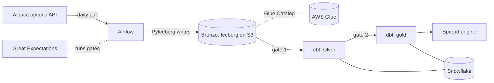

# Architecture

This document describes the target design and marks what exists today. Phase 0 is scaffolding: the infrastructure code, the Airflow stack and the dbt skeleton exist, and the pipeline and engine do not.

## Components

| Component | Role | Phase 0 state |
| --- | --- | --- |
| Alpaca | Source of daily options chains. | Not integrated; Phase 1. |
| Airflow 2.11.2 | Schedules ingest, dbt and the quality gates. LocalExecutor, Postgres metadata DB. | Compose stack runs; one hand-triggered `smoke` DAG that imports `oap`. |
| S3 + Glue Catalog | Storage and catalog for the bronze Iceberg tables. | Terraform defines bucket, database, IAM user. Not applied by default. |
| dbt | Builds silver and gold in Snowflake from bronze. | Project, seed and two models; compiles on DuckDB. |
| Snowflake | Warehouse for silver and gold. | Only a `prod` target in `profiles.yml`; not provisioned. |
| Great Expectations | Validates data at the bronze-to-silver and silver-to-gold boundaries. | `oap.quality` package exists with a documented stub; no suites yet. |
| Spread engine | Pure functions that score put credit spreads. | `oap.engine` package exists with documented stubs; no logic yet. |
| Redpanda | Intraday streaming. | Commented out in `docker-compose.yml`. |

## Data flow

Each layer has one job, and a quality gate decides whether the next layer may build. Gates fail closed: a failed or missing check stops the DAG so bad data does not propagate.

**Bronze** (Phase 1) holds the vendor response as received: one row per contract per snapshot, with the vendor's quote timestamp. Nothing is cleaned here, so any later layer can be rebuilt from it. Loads are idempotent per snapshot date: a re-run replaces that date's partition, and the earlier Iceberg snapshot stays readable. The planned table is `options_chain` in the Glue database `oap_bronze`, partitioned by trade date and underlying. Storage is Iceberg on S3 (ADR 0001).

*Gate 1, bronze to silver:* schema matches what ingest expects, no empty batch, row counts within a plausible range of the prior day, snapshot date equals the run date.

**Silver** (Phase 2) holds cleaned, typed contracts: parsed OCC symbols, real dates and numerics, deduplicated on contract and snapshot, with rows that fail basic sanity (negative prices, bid above ask) flagged or excluded. One row still means one contract on one date. The Phase 0 `stg_watchlist` model (upper-cases and trims symbols from the seed) is the staging pattern in miniature.

*Gate 2, silver to gold:* uniqueness of the contract key, not-null on prices and strikes, bid at or below ask, expiries not in the past, every underlying present in the watchlist.

**Gold** (Phase 2) holds what the engine consumes: per underlying, snapshot and expiry, the usable strikes, mid prices, implied volatility and the risk-free and cash rates, so the engine receives clean inputs and never touches the vendor format. The Phase 0 `dim_underlying` model (a surrogate key per watchlist symbol) is the dimension that gold facts will join to.

There are two gates, one per boundary, each a single Great Expectations suite. The checks listed are the intended ones and will be refined when the suites are written in Phase 2. Whether a gold snapshot has enough strikes to build a distribution is a precondition the engine checks itself.

## Where the engine sits

The engine (`src/oap/engine/`, Phase 3) is the last consumer. It is pure functions with no I/O: prices in dollars, volatility as a decimal, time in years. A thin runner outside the engine reads a gold snapshot, calls the functions and writes ranked candidates back. Keeping I/O out lets hypothesis test the math without a warehouse, and lets a backtest replay any historical gold snapshot, including one pinned to an Iceberg snapshot id.

Three steps, all future:

1. Extract the market-implied distribution of the underlying's price at expiry from vertical spread prices.
2. Calibrate it against realized outcomes from 2019 onward, so a stated probability is checked against how often it happened.
3. Score each candidate put credit spread by expected return on collateral, including interest earned on the held cash (3.6% APY, Robinhood Gold).

## Local stack and cloud stack

| | Local | Cloud |
| --- | --- | --- |
| Orchestration | Airflow in Docker Compose (`docker compose up`), LocalExecutor, Postgres 16 | Not decided; the DAGs are portable to any Airflow 2.11 |
| Bronze | Not stored locally in Phase 0 | S3 bucket and Glue database from `infra/` |
| dbt target | `dev`: DuckDB file `.dbt-local/oap.duckdb` | `prod`: Snowflake, from `SNOWFLAKE_*` env vars |
| dbt runner | `uv run dbt ...` or `docker compose run --rm dbt ...` | Same container, with credentials in the environment |
| Credentials | None needed for `make check` or the Airflow stack | AWS profile for Terraform and ingest; Snowflake user for `prod` |

The local stack is complete for development and CI. Everything in the cloud column needs accounts that Phase 0 does not require: an AWS account for `terraform apply`, a Snowflake trial for `prod`, and Alpaca keys from Phase 1.

The Terraform IAM user is scoped to the one bucket and the one Glue database. Snowflake will need its own role and external volume to read bronze; that is Phase 2 work (ADR 0001).
