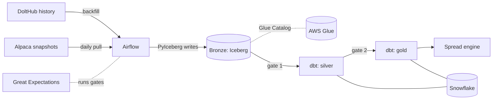

# Architecture

This document describes the target design and marks what exists today. Phase 1 is built: ingestion into the bronze Iceberg table, its quality gate and the three DAGs that run them. The dbt layers above bronze and the spread engine are not built; Phase 2 and Phase 3 will add them.

## Components

| Component | Role | State |
| --- | --- | --- |
| DoltHub | Source of historical chains (2020 onward, free). | Integrated: `oap.ingest.dolthub`, used by `backfill_chains`. |
| Alpaca | Source of daily options snapshots (`indicative` feed). | Integrated: `oap.ingest.alpaca`, used by `daily_chain_snapshot`. |
| Airflow 2.11.2 | Schedules ingest, the quality gate and maintenance (dbt in Phase 2). LocalExecutor, Postgres metadata DB. Image built from `docker/airflow.Dockerfile`. | Runs `backfill_chains`, `daily_chain_snapshot`, `iceberg_maintenance` and the `smoke` DAG. The daily DAG uses `NYSECloseTimetable` from `plugins/oap_timetables.py`. |
| Iceberg catalog | Storage and catalog for the bronze table. | Local by default: a stdlib-SQLite catalog (`oap.ingest.local_catalog`, ADR 0005) and file warehouse in `.iceberg-local/`. S3 + Glue is selected by environment variables; Terraform defines the bucket, database and IAM user and is not applied by default. |
| dbt | Builds silver and gold in Snowflake from bronze. | Project, seed and two models; compiles on DuckDB. |
| Snowflake | Warehouse for silver and gold. | Only a `prod` target in `profiles.yml`; not provisioned. |
| Great Expectations | Validates data at layer boundaries. | The bronze suite exists (`oap.quality.bronze_suite`) and runs as a DAG task after every write. The silver-to-gold gate is Phase 2. |
| Spread engine | Pure functions that score put credit spreads. | `oap.engine` package exists with documented stubs; Phase 3 will add the logic. |
| Redpanda | Intraday streaming. | Commented out in `docker-compose.yml`. |

## Data flow

Each layer has one job, and a quality gate decides whether the next layer may build. In dbt the layers are folders: `models/staging` is silver and `models/marts` is gold; bronze never passes through dbt. Gates fail closed: a failed or missing check stops the DAG so bad data does not propagate.

**Bronze** (Phase 1, built) holds the vendor response as received: one row per contract per day per source. The table is `bronze.option_chain` (in the Glue database named by `OAP_GLUE_DATABASE` when the catalog is Glue), partitioned by `day(trade_date)` and `identity(source)`, so each slice has its own data files. Columns are `trade_date`, `underlying`, `occ_symbol` (compact OCC form such as `SPY240119C00470000`), `expiration`, `strike`, `right`, `bid`, `ask`, `last`, `volume`, `open_interest`, `iv`, `delta`, `gamma`, `theta`, `vega`, `rho`, `underlying_price`, `source` and `ingested_at` (UTC). Eight are non-nullable: `trade_date`, `underlying`, `occ_symbol`, `expiration`, `strike`, `right`, `source` and `ingested_at`. Vendor IV and greeks are kept as received (ADR 0004). Storage is Iceberg (ADR 0001).

Two sources write to it. DoltHub (`source=dolthub`) supplies history from 2020 and has no last, volume, open interest or underlying price, which are stored as nulls. Alpaca (`source=alpaca_indicative`) supplies the daily snapshot from the free `indicative` feed, whose quotes are derived from OPRA rather than the real NBBO, and has no open interest.

**The write rule:** every write goes through `write_partition`, which replaces its (trade_date, source) slice with an overwrite filtered on both columns, and never appends. The uniqueness key is (occ_symbol, trade_date, source). Re-running a day, retrying a task or backfilling over existing data is therefore safe, and deleting a source's day means writing an empty frame (ADR 0003). The cost is that a partial vendor response replaces a full day, which is why the gate runs on what was written.

**The bronze gate** is a Great Expectations suite run after each write (`oap.quality.bronze_suite`). It checks that `occ_symbol` has no nulls, `strike` is above zero, `right` is C or P, there are no duplicates on (occ_symbol, trade_date, source), and each underlying's row count is within 50% of the median of the trailing 20 trading days. An underlying with fewer than 5 days of history is not bounded. A failure raises `BronzeQualityError`, which fails the DAG task; the written slice is not rolled back. The daily DAG runs the suite after its write; the backfill DAG does not run it in Phase 1. This is the bronze half of the gating described below. Rows with a crossed quote (bid above ask) are dropped by the parsers with a logged warning, and the write-time contract enforces `bid <= ask`.

**The DAGs.** `backfill_chains` pulls DoltHub history: one mapped fetch task per (symbol, month), four at a time, then one write task per month that merges the staged symbols into each day's slice and overwrites it. `daily_chain_snapshot` runs at 16:30 America/New_York on NYSE trading days only (`NYSECloseTimetable`, defined in `dags/timetables.py` and registered by `plugins/oap_timetables.py`) and has three tasks: snapshot, write and quality. `iceberg_maintenance` runs weekly: it expires snapshots older than 7 days and compacts by re-writing any (trade_date, source) slice that has more than one data file through the same overwrite path, because pyiceberg 0.12 has no `rewrite_data_files`. Trading days and half days come from `oap.calendar` (NYSE, via `pandas_market_calendars`).

*Gate 1, bronze to silver:* schema matches what ingest expects, no empty batch, row counts within a plausible range of the prior day, snapshot date equals the run date.

**Silver** (Phase 2) holds cleaned, typed contracts: parsed OCC symbols, real dates and numerics, deduplicated on contract and snapshot, with rows that fail basic sanity (negative prices, bid above ask) flagged or excluded. One row still means one contract on one date. The Phase 0 `stg_watchlist` model (upper-cases and trims symbols from the seed) is the staging pattern in miniature.

*Gate 2, silver to gold:* uniqueness of the contract key, not-null on prices and strikes, bid at or below ask, expiries not in the past, every underlying present in the watchlist.

**Gold** (Phase 2) holds what the engine consumes: per underlying, snapshot and expiry, the usable strikes, mid prices, implied volatility and the risk-free and cash rates, so the engine receives clean inputs and never touches the vendor format. The Phase 0 `dim_underlying` model (a surrogate key per watchlist symbol) is the dimension that gold facts will join to.

There are two gates, one per boundary, each a single Great Expectations suite. The bronze suite is built and described above; the checks listed for gate 1 are the original design, and the implemented suite covers the subset in the Bronze paragraph. Gate 2 is Phase 2 work and its checks will be refined when it is written. Whether a gold snapshot has enough strikes to build a distribution is a precondition the engine checks itself.

## Where the engine sits

The engine (`src/oap/engine/`, Phase 3) is the last consumer. It is pure functions with no I/O: prices in dollars, volatility as a decimal, time in years. A thin runner outside the engine reads a gold snapshot, calls the functions and writes ranked candidates back. Keeping I/O out lets hypothesis test the math without a warehouse, and lets a backtest replay any historical gold snapshot, including one pinned to an Iceberg snapshot id.

Three steps, all future:

1. Extract the market-implied distribution of the underlying's price at expiry from vertical spread prices.
2. Calibrate it against realized outcomes from 2020 onward, so a stated probability is checked against how often it happened.
3. Score each candidate put credit spread by expected return on collateral, including interest earned on the held cash at a configurable APY (Robinhood Gold pays 3.6% at the time of writing).

## Local stack and cloud stack

| | Local | Cloud |
| --- | --- | --- |
| Orchestration | Airflow in Docker Compose (`docker compose up`), LocalExecutor, Postgres 16 | Not decided; the DAGs are portable to any Airflow 2.11 |
| Bronze | SQLite catalog and file warehouse in `.iceberg-local/` (`OAP_ICEBERG_CATALOG=sql`) | S3 bucket and Glue database from `infra/` (`OAP_ICEBERG_CATALOG=glue`) |
| dbt target | `dev`: DuckDB file `.dbt-local/oap.duckdb` | `prod`: Snowflake, from `SNOWFLAKE_*` env vars |
| dbt runner | `uv run dbt ...` or `docker compose run --rm dbt ...` | Same container, with credentials in the environment |
| Credentials | None needed for `make check` or the Airflow stack | AWS profile for Terraform and ingest; Snowflake user for `prod` |

The local stack is complete for development and CI, including the DoltHub backfill into the local bronze table. Everything in the cloud column needs accounts the local stack does not require: an AWS account for `terraform apply`, a Snowflake trial for `prod`. The daily Alpaca snapshot needs Alpaca keys in `.env` either way.

The Terraform IAM user is scoped to the one bucket and the one Glue database. Snowflake will need its own role and external volume to read bronze; that is Phase 2 work (ADR 0001).
