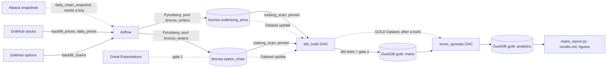

# Architecture

This document describes what is built. Phases 0 to 3 are done on the local stack: ingestion into two bronze Iceberg tables, the quality gates, the Airflow DAGs that run them, the dbt silver and gold layers, and an analytics layer that calibrates the engine's probabilities against outcomes and scores the latest session's spreads. The full DoltHub history is loaded. The cloud targets (S3 and Glue, Snowflake) are configured and compile-checked; no account for them exists, and nothing has run on them. The Alpaca client is built and tested against recorded responses, but no key exists, so it has never run live.

## Components

Each arrow into a DAG that says "Dataset" is an Airflow Dataset event, not a data flow: the data moves through Iceberg and DuckDB.

| Component | Role | State |
| --- | --- | --- |
| DoltHub `options` | Historical chains from 2020 (free, no key). | `oap.ingest.dolthub`, used by `backfill_chains`. |
| DoltHub `stocks` | Daily as-traded OHLCV for the watchlist (free, no key). | `oap.ingest.dolthub_stocks`, used by `backfill_prices` and `daily_prices`. |
| Alpaca | Daily options snapshot, `indicative` feed. | `oap.ingest.alpaca`, used by `daily_chain_snapshot`. |
| Airflow 2.11.2 | Schedules ingest, the bronze gate, maintenance, the dbt build and the analytics. LocalExecutor, Postgres metadata DB. | Eight DAGs, listed below. Image from `docker/airflow.Dockerfile`, installed from `uv.lock` (ADR 0006). |
| Iceberg catalog | Storage and catalog for the bronze tables. | Local by default: a stdlib-SQLite catalog (`oap.ingest.local_catalog`, ADR 0005) and a file warehouse in `.iceberg-local/`. S3 + Glue is selected by environment variables; Terraform defines the bucket, database and IAM user and is not applied by default. |
| dbt | Builds silver, gold and the analytics from bronze. | Project `oap`: 17 models (10 SQL, 7 Python), 8 singular tests. Runs on DuckDB (`dev`), reading bronze through `iceberg_scan` (ADR 0008). |
| DuckDB | Local dbt target and the analytics' input and output store. | `.dbt-local/oap.duckdb`; the synthetic build uses `.dbt-local/synthetic.duckdb`. One writer at a time (pool `duckdb_writer`). |
| Snowflake | Production target for silver and gold. | A `prod` target in `profiles.yml`; not provisioned, and no model has run on it. |
| Great Expectations | Validates bronze. | `oap.quality.bronze_suite` runs on the staged daily chain slice before it is written. The price table has the pandera write contract but no Great Expectations suite. |
| Spread engine | Pure functions that score put credit spreads. | `oap.engine`, built and tested, with `hypothesis` property tests. |
| Analytics | Walk-forward calibration of the engine's probabilities and scoring of the latest session. | `oap.analytics` (pure frame functions) behind seven dbt Python models; `scripts/make_report.py` writes the report. DuckDB only. |
| Explorer | A local web app to look at the distributions, the calibration and the ranked spreads. | `oap.api` (FastAPI: read-only DuckDB, in-memory cache, `oap.analytics` for every number) and `apps/web` (React and visx). Host processes (`make app`, `make serve`), bound to 127.0.0.1. ADR 0011. |
| Redpanda | Intraday streaming. | Commented out in `docker-compose.yml`. |

## Bronze

Bronze holds the vendor response as received. Both tables are partitioned by `day(trade_date)` and `identity(source)`, and both are described by a `TableSpec` in `oap.ingest.tables` (`OPTION_CHAIN`, `UNDERLYING_PRICE`, collected in `BRONZE_TABLES`). The writer, reader, merge helper and maintenance DAG are generic over the spec, so a new bronze table is one more spec.

**`bronze.option_chain`** has one row per contract per day per source. Columns are `trade_date`, `underlying`, `occ_symbol` (compact OCC form such as `SPY240119C00470000`), `expiration`, `strike` (decimal(10,3)), `right`, `bid`, `ask`, `last`, `volume`, `open_interest`, `iv`, `delta`, `gamma`, `theta`, `vega`, `rho`, `underlying_price`, `source` and `ingested_at` (UTC). Eight are non-nullable: `trade_date`, `underlying`, `occ_symbol`, `expiration`, `strike`, `right`, `source` and `ingested_at`. The key is (occ_symbol, trade_date, source). Two sources write to it. DoltHub (`source=dolthub`) supplies history and has no last, volume, open interest or underlying price. Alpaca (`source=alpaca_indicative`) supplies the daily snapshot, whose quotes are derived from OPRA rather than the real NBBO, and has no open interest. Vendor IV and greeks are kept as received (ADR 0004). DoltHub's chains cover 2020-01-06 onward with about 70% of sessions present. The table holds 1,811,734 rows over 1,194 trading days up to 2026-10-02, for 11 underlyings (AAPL 1,191 days, AMD 1,188, AMZN 1,187, DIA 1,189, GOOGL 1,182, META 822, MSFT 1,177, NVDA 1,186, SPY 1,180, TSLA 1,037, XLF 1,179).

**`bronze.underlying_price`** has one daily bar per underlying per source: `trade_date`, `underlying`, `open`, `high`, `low`, `close`, `volume`, `source` (`dolthub_stocks`) and `ingested_at`. The key is (underlying, trade_date, source). Prices are dollars per share as traded, not adjusted for splits or dividends, because option strikes are quoted against the as-traded price (ADR 0007). `open` is not range-checked, as one vendor row has it above the high. The table holds 18,190 rows over 1,697 sessions, 2020-01-02 to 2026-10-02.

**The write rule.** Every write goes through `write_partition`, which replaces its (trade_date, source) slice with one overwrite commit and never appends, so re-runs, retries and overlapping backfills converge on the same table (ADR 0003). A slice holds every underlying of a day, so the backfills and the daily price DAG go through `merge_into_slices` (`oap.ingest.merge`): it replaces only the underlyings the vendor returned rows for, keeps the rest, and skips a slice whose content did not change. An empty response never deletes loaded rows. `ingested_at` is the time the slice was written, stamped by the merge, so it works as a commit watermark for what is downstream. A re-run over unchanged data writes nothing and adds no Iceberg snapshot (the content hash excludes `ingested_at`).

**The watchlist** is the dbt seed `dbt/seeds/watchlist.csv`, read by the DAGs when `symbols` is empty. It has 11 symbols: SPY, DIA, XLF, AAPL, MSFT, NVDA, AMZN, GOOGL, META, TSLA and AMD. QQQ and IWM were dropped because DoltHub holds no options history for them.

**Serialising writers.** The SQLite catalog allows one writer. Every task that commits to bronze runs in the Airflow pool `bronze_writers`, which has one slot (created by `airflow-init`): the write tasks of `backfill_chains`, `daily_chain_snapshot`, `backfill_prices` and `daily_prices`, and both tasks of `iceberg_maintenance`. They queue behind each other instead of racing for the lock. DuckDB has the same limit, so a second pool, `duckdb_writer`, also has one slot and holds every task that opens `oap.duckdb`: `dbt_build`, and `analytics` and `report` of `score_spreads`. Both pools are created by `airflow-init`.

**Failing fast.** Retries exist for flaky networks. The decorator `fail_fast` (`dags/common.py`), applied under `@task`, turns errors a retry cannot fix into `AirflowFailException`: any `ValueError` (including `pyarrow.ArrowInvalid`), pandera `SchemaErrors`, `BronzeQualityError`, bad Alpaca credentials, an HTTP 4xx other than 429, and a snapshot for the wrong session. A `DoltHubError` or `AlpacaError` fails fast too, unless it carries a retryable cause (a timeout, HTTP 429 or 5xx that outlasted the client's own retries); those and transport errors still retry. The `plan` tasks reject malformed symbols before any fetch.

## Pipelines

| DAG | Schedule | What it does | Pool | Emits Dataset |
| --- | --- | --- | --- | --- |
| `smoke` | Manual | Imports `oap` on a worker. | | |
| `backfill_chains` | Manual (`start`, `end`, `symbols`) | One fetch per (symbol, month), four at a time; one merge-and-write per month. | `bronze_writers` on `write_month` | `option_chain`, from `summarize` |
| `daily_chain_snapshot` | 16:30 America/New_York on NYSE sessions | `snapshot >> quality >> write`: the gate runs on the staged slice before anything is committed, so a failed gate publishes nothing. | `bronze_writers` on `write` | `option_chain`, from `write` |
| `backfill_prices` | Manual (`start`, `end`, `symbols`) | One DoltHub query per month for all symbols; one merge-and-write per month. | `bronze_writers` on `write_month` | `underlying_price`, from `summarize` |
| `daily_prices` | 16:30 America/New_York on NYSE sessions | `fetch >> write` over a trailing window of five sessions; `write` skips when no slice changed. | `bronze_writers` on `write` | `underlying_price`, from `write` (not on a skipped run) |
| `iceberg_maintenance` | `@weekly` | Expires snapshots older than 7 days, then compacts multi-file slices, in both tables. | `bronze_writers` | |
| `dbt_build` | On either bronze Dataset | `dbt_build >> publish_gold`: runs `dbt build` (or `dbt test`) over the pinned bronze snapshot, excluding `tag:analytics`; `publish_gold` skips unless the mode is `build`. | `duckdb_writer` on `dbt_build` | `gold`, from `publish_gold` (not on a skipped run) |
| `score_spreads` | On the `gold` Dataset | `analytics >> report`: `dbt build --select tag:analytics`, then `make_report.py` into `.dbt-local/report/`. `analytics` has no retries. | `duckdb_writer` on both | `gold/analytics`, from `analytics` |

The daily DAGs use `NYSECloseTimetable` (`dags/timetables.py`, registered by `plugins/oap_timetables.py`). Trading days come from `oap.calendar`.

DoltHub commits a session's bars at about 05:30 UTC on the next day. `daily_prices` therefore lags one session: the run for day D picks up D-1 and fills any gap in the five-session window, and D's own bar arrives with the run for D+1.

**Dataset scheduling.** `dags/datasets.py` defines four Datasets: `iceberg://oap/bronze/option_chain` and `iceberg://oap/bronze/underlying_price`, `duckdb://oap/gold` and `duckdb://oap/gold/analytics`. A producer task lists one in `outlets`, and Airflow records an update when that task succeeds. `dbt_build` is scheduled on `option_chain | underlying_price`, so either update starts a run, and `max_active_runs=1` makes a second run wait for the first. `score_spreads` is scheduled on `gold`, which only `publish_gold` updates, and only after a `build` run whose models and tests all passed. The chain is therefore bronze, then `dbt_build`, then `score_spreads`, and a failing silver or gold test stops the analytics. Nothing consumes `gold/analytics` yet. The URIs are identifiers; Airflow never reads them.

## Silver and gold

The dbt project reads bronze, builds the silver and gold schemas and tests them. Silver is `staging` plus `intermediate` (schema `silver`); gold is `marts` and `analytics` (schema `gold`; the analytics models are in their own section below). Bronze never passes through dbt models; it is a source.

**Reading bronze.** The `register_bronze` hook (`dbt/macros/register_bronze.sql`) reads each table's committed `metadata_location` from the SQLite catalog, pins that metadata version for the whole run, and creates the views `bronze.option_chain` and `bronze.underlying_price` over `iceberg_scan`. Models and tests therefore read one snapshot even while a backfill commits. `OAP_DBT_SOURCE` selects the catalog: `iceberg` (the real one), `synthetic` (written by `scripts/make_synthetic_bronze.py` through the real writer, used by `make check` and CI) or `auto`. A DuckDB file built from one mode refuses to build from the other. On Snowflake the hook does nothing and the sources point at `OAP_SNOWFLAKE_BRONZE_DATABASE` and `OAP_SNOWFLAKE_BRONZE_SCHEMA` (ADR 0008).

| Model | Layer | Materialisation | Grain |
| --- | --- | --- | --- |
| `stg_watchlist` | silver | view | symbol |
| `stg_option_chain` | silver | view | occ_symbol, trade_date, source |
| `stg_underlying_price` | silver | view | underlying, trade_date |
| `int_option_quotes` | silver | view | occ_symbol, trade_date |
| `int_chain_snapshots` | silver | table | underlying, trade_date, expiration |
| `dim_underlying` | gold | table | symbol |
| `dim_contract` | gold | table | occ_symbol |
| `fct_option_quote` | gold | incremental, delete+insert on trade_date | occ_symbol, trade_date |
| `fct_underlying_daily` | gold | table | underlying, trade_date |
| `fct_expiration_outcome` | gold | table | underlying, expiration |

`stg_option_chain` renames and filters: it drops rows with a non-positive strike, an expiration before the trade date or a crossed quote. `int_option_quotes` keeps one quote per contract per day (DoltHub wins over Alpaca when both cover a contract-day), adds `mid`, `spread`, `dte_days`, `dte_years` (calendar days over 365) and `moneyness`, and attaches `underlying_close`: the stocks close when a price row exists, the chain vendor's price otherwise, with `underlying_close_source` saying which. `fct_option_quote` is the engine's input. It is incremental on a watermark, `trade_date_ingested_at`: per trade date, the greater of the latest chain write and the latest price write, so a price that lands late moves the watermark too. `fct_underlying_daily` holds as-traded bars with simple and log returns; split days show as large moves and a warn-level test flags them. `fct_expiration_outcome` holds the settlement close of every expiration seen in the chains: the close on the expiration date, or on the last session within four days before it when the expiration falls on a holiday or weekend.

Every model has descriptions on every column and at least two tests, which `tests/dbt/test_project.py` enforces. Across the models that is 109 schema tests, plus 8 singular tests. A silver and gold build over 1.48 million option rows took about 12 seconds; no timing is recorded for the analytics models.

## The two gates

A gate decides whether the next layer may build, and fails closed.

**Gate 1, bronze: Great Expectations.** `oap.quality.bronze_suite` checks that `occ_symbol` has no nulls, `strike` is above zero, `right` is C or P, the key (occ_symbol, trade_date, source) is unique, and each underlying's row count is within 50% of the median of the trailing 20 sessions (underlyings with fewer than 5 days of history are not bounded). It runs in the `quality` task of `daily_chain_snapshot`, on the staged frame, before the `write` task commits it (ADR 0003, amended). A failure raises `BronzeQualityError` and fails the run before the slice is touched, so a slice that fails the gate is never published and the previous slice of that session stays in place. After the commit, `write` reads the slice back and checks its row count against the staged frame. The backfills do not run the suite; check them with `make iceberg-count`. Before every write, a pandera contract (`BRONZE_FRAME`, `PRICE_FRAME`) rejects malformed frames and commits nothing.

**Gate 2, silver to gold: dbt tests.** The tests run in `dbt build` in dependency order, and a test failing at error severity skips every model downstream of it and fails the `dbt_build` task. Beyond the column tests in the `schema.yml` files there are eight singular tests. Three guard silver and gold:

- `assert_close_within_strike_range`: a day's close must lie inside the strike range of that day's chain. It catches a split-adjusted close set against as-traded strikes.
- `assert_fct_option_quote_matches_silver`: per trade date, gold must match the silver view in row count and in a checksum of `underlying_close`. It catches drift the incremental watermark cannot see, such as a deleted bronze slice or a corrected price. The fix is a full refresh.
- `assert_synthetic_row_counts`: expected row counts of every silver and gold model on the synthetic catalog. It exists only when `OAP_DBT_SOURCE=synthetic`.

Four more guard the analytics and run only in `score_spreads` (tagged `analytics`, enabled on DuckDB only): `assert_calibration_out_of_sample` (the leakage gate), `assert_calibration_map_monotone`, `assert_predictions_from_ok_snapshots` and `assert_spread_rank_contiguous`. The eighth, `assert_synthetic_analytics_counts`, pins the analytics row counts and exists only on the synthetic catalog. A failure in any of them fails the `analytics` task, which is never retried, so the report is not written from a build that failed its own checks.

## The engine

`src/oap/engine/` is a package of pure functions on numpy arrays: no I/O, no clock, no scipy. The units and conventions are fixed across it (ADR 0009): prices in dollars per share, volatility as a decimal, time in years on ACT/365, rates as decimal APY, probabilities as decimals. Invalid input raises `EngineInputError`.

| Module | What it provides |
| --- | --- |
| `conventions` | `dte_years` (ACT/365), `growth_factor`, `discount_factor`, `continuous_rate`. |
| `black_scholes` | Prices, delta, vega, no-arbitrage bounds, put-call parity forward and a vectorised bisection `implied_vol` that returns nan outside the bounds. |
| `implied_distribution` | `implied_cdf` builds a risk-neutral CDF of the price at expiry from vertical put spreads, with calls converted through parity. It repairs the raw slopes with weighted pool-adjacent-violators isotonic regression, clips to [0, 1], holds the CDF flat beyond the outer strikes, and reports what happened through `QualityFlag` (`NO_CALLS`, `FORWARD_UNKNOWN`, `MONOTONICITY_REPAIRED`, `CLIPPED`, `LEFT_TAIL_UNCOVERED`, `RIGHT_TAIL_UNCOVERED`, `SPARSE`, `CALIBRATED`). |
| `calibration` | Reliability table, Brier score, log loss, expected calibration error, an isotonic `CalibrationMap` (with `to_frame` and `from_frame`) and `apply_calibration`. |
| `spread_scoring` | `PutCreditSpread` and `SpreadScore`: probability of profit, probability of maximum loss, expected payoff, interest on the collateral at the cash APY, return on collateral, annualised return and Kelly fraction; `enumerate_spreads` and `rank_spreads`. |

The engine's tests include a property test that a lognormal chain is recovered. The engine does not read the warehouse. Reading gold and writing results is the job of the analytics layer (next section). That keeps the math testable with `hypothesis` and lets a backtest replay any historical snapshot.

## Analytics

The analytics layer answers whether the probabilities implied by option prices match what happened, and ranks the latest session's put credit spreads with the answer applied. ADR 0010 records the design. It has three parts.

**A pure core.** `src/oap/analytics/` takes and returns pandas frames. `config` holds every parameter (the moneyness grid, the 7-day minimum to expiry, the 0.4 split threshold, the ticker-reuse date, the rates). `sample` turns a chain into a snapshot status and a set of labelled predictions. `backtest` fits and applies the calibration maps and computes metrics. `scoring` scores and ranks spreads. `io` is the only module that reads a relation, through a duck-typed protocol.

**Seven dbt Python models** in `dbt/models/analytics/`, tagged `analytics`, each a wrapper around one function of the core, written to the `gold` schema. They run in dbt-duckdb's in-process runner and are disabled on other targets.

| Model | Grain | Holds |
| --- | --- | --- |
| `calibration_snapshot` | underlying, trade date, expiration | The snapshot status: `ok`, or the first exclusion that applied (`ticker_reused`, `too_short`, `no_close`, `too_few_puts`, `unsettled`, `split_in_window`), with settlement and put and call counts. |
| `calibration_prediction` | snapshot and moneyness | The risk-neutral P(S < K) at 13 strikes from 0.80 to 1.10 times the close, and whether the settlement close was below the strike. Targets outside the CDF's strike range are skipped. |
| `calibration_map` | map and knot | The isotonic maps: one `fold_<year>` per test year and `production`. |
| `calibration_sample` | prediction | Each prediction with its fold map applied; `is_out_of_sample` marks the rows the metrics use. |
| `calibration_metrics` | segment, variant, metric | Brier score, log loss and expected calibration error for raw and calibrated probabilities, overall and by underlying, days to expiry and fold year, with a cluster-bootstrap interval. |
| `calibration_bins` | variant, bin | The reliability table behind `docs/img/calibration.png`. |
| `spread_scores` | underlying, expiration, strikes | Every put credit spread of the latest session in gold, scored under the raw and the production-calibrated CDF, with an eligibility flag and a rank. |

**The method.** Calibration is walk-forward by year. The map applied to year Y is fitted only on predictions whose expiration is before 1 January of Y; 2020 is burn-in and 2021 is the first test year. Predictions that resolve on the same date share one market move, so the interval resamples expiration dates. The risk-free rate is a constant 4.5% APY and the cash rate on collateral is 3.6% APY; Phase 4 will replace the constant with the daily FRED DTB3 yield. `spread_scores` ranks on the global latest session in gold, so an underlying whose feed stopped is not ranked beside fresh ones, and orders the eligible spreads by calibrated annualised return on collateral.

**The report.** `scripts/make_report.py` reads the gold tables read-only and writes `results.md` and two figures. In `score_spreads` it writes to `.dbt-local/report/`; `make report` writes the committed copy in `docs/` and replaces the excerpt between the `results` markers in `README.md`. Its output is deterministic, so a second run on the same database changes nothing. `make check` renders it from the synthetic gold schema, so the models and the report's SQL cannot drift apart unnoticed. The figures, tables and caveats are in [results.md](results.md), generated from the data; this document states no calibration result.

## Local stack and cloud stack

| | Local | Cloud |
| --- | --- | --- |
| Orchestration | Airflow in Docker Compose, LocalExecutor, Postgres 16 | Not decided; the DAGs are portable to any Airflow 2.11 |
| Bronze | SQLite catalog and file warehouse in `.iceberg-local/` (`OAP_ICEBERG_CATALOG=sql`) | S3 bucket and Glue database from `infra/` (`OAP_ICEBERG_CATALOG=glue`) |
| dbt runner | `/opt/dbt-venv` in the Airflow image (the `dbt_build` DAG), `uv run dbt ...` on the host, or `docker compose run --rm dbt ...` | The same, with credentials in the environment |
| dbt target | `dev`: DuckDB file `.dbt-local/oap.duckdb`, with the iceberg, avro and sqlite extensions baked into the image at `/opt/duckdb-extensions` | `prod`: Snowflake, from `SNOWFLAKE_*` variables. The seven analytics models are disabled there; Phase 4 will add them as Snowpark Python models |
| dbt reads bronze | `iceberg_scan` over the local catalog, pinned per run | External Iceberg tables named by `OAP_SNOWFLAKE_BRONZE_DATABASE` and `_SCHEMA`; nothing in `infra/` creates them yet |
| Credentials | None for `make check` or the Airflow stack | AWS profile for Terraform and ingest; Snowflake user for `prod` |

The local stack is complete for development and CI, including the DoltHub chain and price history, the dbt build, the analytics and the report. Everything in the cloud column needs accounts the local stack does not: an AWS account for `terraform apply`, a Snowflake trial for `prod`. The daily Alpaca snapshot needs Alpaca keys in `.env` either way.

The Terraform IAM user is scoped to the one bucket and the one Glue database. Snowflake will need its own role, an external volume and external tables over the Glue tables; none exists (ADR 0001).
