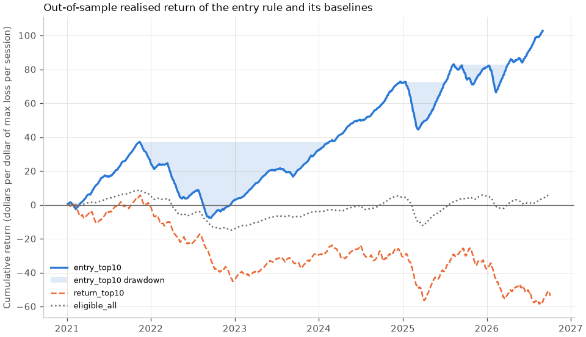

# Strategy backtest: the Top 10 rule applied historically

`entry_top10` takes, on every session, the spreads the live ranking would have listed under "Top 10 to enter": Passes every guard (eligible, calibrated POP ≥ 65%, credit ≥ $0.25, natural credit ≥ 50% of mid with positive natural edge, inside quoted strikes, no tail flags), 45 to 69 days to expiry, short strike 95% to below 100% of the close, ranked by annualised natural return with the POP shrunk halfway toward the market-implied POP, then annualised return on max loss and reward/risk. Each session is scored by the same code as the latest one, with only the calibration map that existed at the time. The rule changed on 2026-10-20: until then `entry_top10` followed "Passes every guard (eligible, calibrated POP ≥ 65%, credit ≥ $0.25, natural credit ≥ 50% of mid with positive natural edge, inside quoted strikes, no tail flags), ranked by annualised return on max loss, then reward/risk.", which this backtest measured at 10,458 out-of-sample trades from 2021-01-04 to 2026-10-05 that won 64.1% against 73.0% predicted and returned -2.04% on capital at risk, so the product moved to the rule above, the rule-lab rule that held up on the 2025-2026 hold-out (`docs/rule-lab.md`).

Sessions scored: 1,047 (2021-01-04 to 2026-10-05); with at least one `entry_top10` trade: 991. Trades dropped as unsettled: 0. Out-of-sample trades: `entry_top10` 9,842, `return_top10` 10,470, `eligible_all` 919,631.

## Out of sample, overall

`entry_top10` is the live entry ranking: `rank_entry` (the rule above); `return_top10` is the top 10 by `rank` (raw annualised return on max loss, without the entry guards); `eligible_all` is every eligible spread, equal weight (the no-selection baseline).

| Strategy | Trades | Sessions | Win rate (95% CI) | Predicted POP | POP gap | Mean realised return (95% CI) | Mean predicted return | Total return on capital at risk | Median return | Worst trade | Max-loss rate | Sharpe per trade | Max drawdown ($1/trade) | Max drawdown ($1/session) | Avg DTE |
| --- | ---: | ---: | ---: | ---: | ---: | ---: | ---: | ---: | ---: | ---: | ---: | ---: | ---: | ---: | ---: |
| `entry_top10` | 9,842 | 991 | 76.2% (70.2% to 82.0%) | 77.5% | -1.3 pp | 10.3% (0.9% to 19.0%) | 12.97% | -3.05% | 35.14% | -100.0% | 15.6% | 0.19 | 450.58 | 45.06 | 54.3 |
| `return_top10` | 10,470 | 1,047 | 62.5% (59.0% to 65.3%) | 70.3% | -7.8 pp | -5.1% (-10.0% to -0.7%) | 24.94% | -5.91% | 28.21% | -100.0% | 29.8% | -0.07 | 642.45 | 64.25 | 15.5 |
| `eligible_all` | 919,631 | 1,047 | 82.8% (80.5% to 84.7%) | 85.6% | -2.7 pp | 0.5% (-2.0% to 2.5%) | 6.47% | -0.43% | 6.89% | -100.0% | 9.3% | 0.01 | 19457.08 | 23.76 | 32.5 |

Returns are on max loss over the holding period. The realised return fills at the natural credit; the predicted return is the score's `expected_roc` (mid credit, interest on the collateral included), so part of the gap is the half-spread and the interest. The interval resamples expiration dates (trades expiring together share one market move). Drawdowns are in dollars per dollar of maximum loss, booked by session: $1/trade puts one dollar of maximum loss on every trade, $1/session splits one dollar equally across a session's trades, which puts strategies with different trade counts on one scale.

## By year (`entry_top10`)

| Year | Trades | Sessions | Win rate | Predicted POP | POP gap | Mean realised return | Mean predicted return | Total return on capital at risk | Max-loss rate | Max drawdown ($1/trade) |
| --- | ---: | ---: | ---: | ---: | ---: | ---: | ---: | ---: | ---: | ---: |
| 2021 | 1,370 | 137 | 78.0% | 83.3% | -5.4 pp | 18.13% | 26.81% | -7.45% | 13.2% | 124.07 |
| 2022 | 1,334 | 134 | 54.3% | 83.9% | -29.5 pp | -16.51% | 24.28% | -36.32% | 32.3% | 326.52 |
| 2023 | 1,368 | 139 | 87.1% | 73.4% | +13.7 pp | 21.15% | 3.69% | 19.43% | 6.8% | 50.35 |
| 2024 | 1,717 | 174 | 90.7% | 77.2% | +13.4 pp | 22.86% | 7.13% | 21.45% | 3.7% | 8.93 |
| 2025 | 2,413 | 243 | 71.0% | 75.4% | -4.4 pp | 3.76% | 10.22% | -0.94% | 21.1% | 280.72 |
| 2026 | 1,640 | 164 | 75.9% | 74.2% | +1.7 pp | 13.08% | 10.09% | 9.36% | 15.4% | 158.78 |

## By underlying (`entry_top10`)

| Underlying | Trades | Sessions | Win rate | Predicted POP | POP gap | Mean realised return | Mean predicted return | Total return on capital at risk | Max-loss rate | Max drawdown ($1/trade) |
| --- | ---: | ---: | ---: | ---: | ---: | ---: | ---: | ---: | ---: | ---: |
| AAPL | 947 | 430 | 67.9% | 77.7% | -9.8 pp | 3.29% | 16.53% | 2.32% | 20.7% | 81.19 |
| AMD | 179 | 78 | 84.9% | 75.6% | +9.3 pp | 32.45% | 19.41% | 29.32% | 5.6% | 10.57 |
| AMZN | 1,117 | 453 | 61.2% | 76.7% | -15.4 pp | -4.97% | 18.14% | -24.36% | 27.8% | 160.52 |
| DIA | 324 | 141 | 79.0% | 82.8% | -3.8 pp | 4.28% | 11.99% | 7.09% | 12.3% | 24.23 |
| GOOGL | 610 | 351 | 73.0% | 75.0% | -2.1 pp | 11.97% | 15.74% | -13.01% | 18.2% | 60.62 |
| META | 1,353 | 333 | 75.0% | 71.4% | +3.7 pp | 14.20% | 10.77% | 6.76% | 19.3% | 175.85 |
| MSFT | 832 | 394 | 63.6% | 75.0% | -11.4 pp | -2.79% | 13.48% | -3.56% | 25.1% | 120.32 |
| NVDA | 807 | 248 | 87.9% | 74.6% | +13.2 pp | 35.01% | 16.71% | 33.15% | 6.2% | 20.65 |
| SPY | 3,452 | 766 | 83.7% | 81.6% | +2.1 pp | 11.35% | 9.34% | 10.09% | 9.1% | 124.15 |
| TSLA | 181 | 45 | 80.1% | 72.4% | +7.7 pp | 24.68% | 15.15% | 29.71% | 16.0% | 28.58 |
| XLF | 40 | 22 | 80.0% | 83.8% | -3.8 pp | 16.28% | 12.48% | 7.87% | 5.0% | 2.49 |

## Worst 10 trades (`entry_top10`, out of sample)

| Session | Underlying | Expiration | Short/long | Natural credit | POP calibrated | Settlement close | Payoff | Realised return |
| --- | --- | --- | ---: | ---: | ---: | ---: | ---: | ---: |
| 2021-01-20 | AAPL | 2021-03-19 | 127.5/120 | 2.50 | 83.4% | 119.99 | -5.00 | -100.0% |
| 2021-01-20 | AAPL | 2021-03-19 | 127.5/122.5 | 1.75 | 83.4% | 119.99 | -3.25 | -100.0% |
| 2021-01-20 | AAPL | 2021-03-19 | 130/120 | 3.65 | 79.1% | 119.99 | -6.35 | -100.0% |
| 2021-01-20 | AAPL | 2021-03-19 | 130/125 | 2.05 | 74.5% | 119.99 | -2.95 | -100.0% |
| 2021-01-20 | AAPL | 2021-03-19 | 130/127.5 | 1.05 | 74.5% | 119.99 | -1.45 | -100.0% |
| 2021-01-22 | AAPL | 2021-03-19 | 137.5/130 | 3.15 | 74.5% | 119.99 | -4.35 | -100.0% |
| 2021-01-22 | AAPL | 2021-03-19 | 137.5/132.5 | 2.15 | 74.5% | 119.99 | -2.85 | -100.0% |
| 2021-01-22 | AMZN | 2021-03-19 | 3160/3095 | 22.25 | 83.4% | 3074.96 | -42.75 | -100.0% |
| 2021-01-22 | AMZN | 2021-03-19 | 3290/3095 | 82.20 | 74.5% | 3074.96 | -112.80 | -100.0% |
| 2021-01-22 | AMZN | 2021-03-19 | 3290/3160 | 57.65 | 72.3% | 3074.96 | -72.35 | -100.0% |

Cumulative realised return on max loss of the out-of-sample trades, one dollar of maximum loss per session split across its trades; the shading is the drawdown of `entry_top10` below its running peak.

## Caveats

Fills are at the natural credit (short bid minus long ask) at the end-of-day close, with no commissions, no slippage beyond that, no early management and no early assignment: every spread is held to expiry and settled at the settlement close. Positions overlap (a new set of spreads is entered every session while earlier ones are still open), and each trade is counted as one dollar of maximum loss, so the totals are not a compounded account balance. Each session uses the walk-forward map of its year, fitted only on expirations before 1 January; sessions before 2021 are burn-in and excluded, and the production map is never used. Only snapshots the calibration sample keeps (`ok` status) are ranked, so a chain whose window contains a split is left out, which uses hindsight about the split. The universe is today's large caps (hindsight in the universe biases realised losses low), the vendor history misses some sessions, and the eligible-all baseline is a measurement, not a tradeable portfolio. This is a historical measurement of a ranking, not trade advice.
