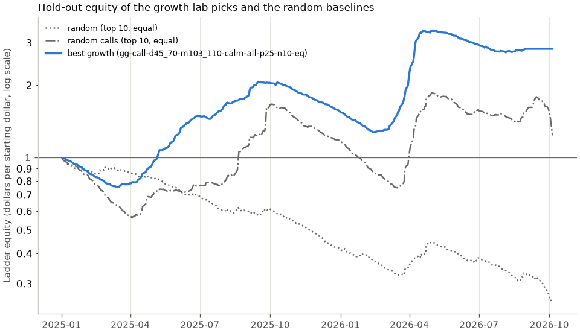

# Growth lab: growth-optimal single options on a hold-out

Every usable long call and put of every session from 2021-01-04 to 2026-10-05 was scored at the ask, with its growth-optimal fraction of capital and growth rate, under the pooled walk-forward map of the trade date's year (step 1 found the regime maps no better): out-of-sample Brier difference regime minus pooled +0.0057 (95% interval +0.0041 to +0.0071). 25,920 rules that pick the top options by growth rate each session, size them equally or by that fraction and hold them to expiry were ranked on the dev years (2021-2024) and are reported on the hold-out (2025-2026), which no choice looked at. The answer is reported whether it is positive or negative.

## Headline (hold-out)

| Pick | Rule | Hold-out trades | Win rate | Predicted POP | Mean return on premium (95% CI) | Log growth per session (bet line) | Sharpe per session | Ladder total growth | Ladder max drawdown | Mean tail share |
| --- | --- | ---: | ---: | ---: | ---: | ---: | ---: | ---: | ---: | ---: |
| Baseline | random, equal weight, top 10 | 4,350 | 27.8% | 28.3% | -16.03% (-24.36% to -6.23%) | -5.397% | -0.229 | -74.5% | 74.5% | 27.4% |
| Baseline, calls only | random calls, equal weight, top 10 | 4,350 | 32.9% | 36.3% | 10.51% (-9.35% to 30.81%) | -0.679% | 0.083 | 23.6% | 55.2% | 45.3% |
| Best growth | `gg-call-d45_70-m103_110-calm-all-p25-n10-eq` | 3,763 | 32.8% | 33.6% | 37.05% (-1.81% to 87.31%) | 2.535% | 0.199 | 182.8% | 38.2% | 58.5% |

**Best growth: `gg-call-d45_70-m103_110-calm-all-p25-n10-eq`.** Rank by calibrated minus market growth-optimal log growth; calls only; 45 to 69 days to expiry; strike from 103% to below 110% of the close; only when the near-the-money IV rose less than 20% over 5 sessions; calibrated probability of profit at least 25%; top 10 per session, 25% of equity split equally. It has the highest dev growth per session of every rule with enough dev trades. On dev it made 5,095 trades with a log growth of 5.386% per session and a mean return on premium of 51.07% (random baseline -6.420% and -17.06%). On the hold-out it made 3,763 trades, won 32.8% against a predicted 33.6%, returned 37.05% (-1.81% to 87.31%) on premium per trade, with a log growth of 2.535% per session on the bet line and a total of 182.8% on the ladder line (random baseline -5.397% and -74.5%, calls-only baseline -0.679% and 23.6%). Its hold-out interval of the mean return includes zero, so a positive mean return is not established at 95% on the hold-out alone.

**Best growth, low drawdown:** the same rule; its dev ladder drawdown is below the median of the qualifying rules (73.8%).

The bet line treats each session's picks as one bet sized as the rule says, as if no other bet were open: its mean log growth per session (over every hold-out session; a session without a trade adds 0) is the realised counterpart of the growth rate and ranks the rules, and the Sharpe ratio is of its session returns. Its compounded total is not an account, because the options are held for weeks. The ladder line spreads each pick's stake over the sessions until its expiry, so about the rule's share of equity is committed at a time; its total growth and its largest fall below its running peak approximate a feasible account. The mean return is per trade on premium at the ask, held to expiry; its interval resamples expiration dates.

## Top 10 rules on dev, with their hold-out results

Ranked by dev growth per session among the 20,297 rules with at least 400 dev trades; the hold-out columns are the honest numbers. Rule ids read ranking (`gr` growth rate, `gg` growth gap over the market, `er` expected return), right, DTE band (`dany` for all), strike-over-close band in percent (`many` for all), regime gate (`any`, `calm`, `up`, `ivh` high IV rank, `ivl` low IV rank), `one` option per underlying and expiry or `all`, minimum probability of profit in percent, options per session and sizing (`eq` equal, `kelly` growth-optimal fractions).

| # | Rule | Dev trades | Dev log growth per session | Dev mean return | Dev ladder max drawdown | Hold-out trades | Hold-out win rate | Hold-out predicted POP | Hold-out mean return (95% CI) | Hold-out log growth per session | Hold-out ladder total growth | Hold-out ladder max drawdown | Hold-out Sharpe |
| --- | --- | ---: | ---: | ---: | ---: | ---: | ---: | ---: | ---: | ---: | ---: | ---: | ---: |
| 1 | `gg-call-d45_70-m103_110-calm-all-p25-n10-eq` | 5,095 | 5.386% | 51.07% | 65.0% | 3,763 | 32.8% | 33.6% | 37.05% (-1.81% to 87.31%) | 2.535% | 182.8% | 38.2% | 0.199 |
| 2 | `gr-call-d45_70-m103_110-calm-all-p25-n10-eq` | 5,095 | 5.367% | 50.86% | 64.9% | 3,763 | 32.9% | 33.6% | 37.31% (-1.82% to 87.54%) | 2.571% | 184.4% | 38.2% | 0.200 |
| 3 | `gg-call-d45_70-m103_110-calm-all-p25-n5-eq` | 2,704 | 5.331% | 58.52% | 61.3% | 1,937 | 32.7% | 33.9% | 30.59% (-12.60% to 90.93%) | 0.723% | 145.5% | 39.9% | 0.157 |
| 4 | `gr-call-d45_70-m103_110-calm-all-p25-n5-eq` | 2,704 | 5.298% | 58.71% | 61.4% | 1,937 | 32.8% | 33.9% | 31.25% (-12.40% to 91.97%) | 0.833% | 149.7% | 39.9% | 0.160 |
| 5 | `er-call-d45_70-m103_110-calm-all-p25-n10-eq` | 5,095 | 5.295% | 51.83% | 64.3% | 3,763 | 31.1% | 32.1% | 38.29% (-4.43% to 91.89%) | 2.488% | 190.8% | 37.9% | 0.200 |
| 6 | `er-call-dany-m103_110-calm-one-p25-n10-eq` | 5,716 | 5.107% | 45.13% | 75.2% | 4,221 | 26.0% | 30.0% | 19.54% (-7.41% to 49.02%) | -0.577% | 26.4% | 61.8% | 0.111 |
| 7 | `er-call-d45_70-m103_110-calm-all-p25-n5-eq` | 2,704 | 5.104% | 61.23% | 62.6% | 1,937 | 29.7% | 31.6% | 33.43% (-10.08% to 96.50%) | 0.584% | 161.4% | 39.0% | 0.159 |
| 8 | `er-call-d45_70-m103_110-calm-all-p25-n10-kelly` | 5,033 | 5.053% | 52.44% | 63.7% | 3,724 | 31.1% | 32.1% | 37.17% (-5.70% to 89.42%) | 2.361% | 161.9% | 36.4% | 0.196 |
| 9 | `gg-both-d45_70-m103_110-calm-all-p25-n10-kelly` | 5,033 | 5.043% | 51.69% | 64.7% | 3,724 | 32.8% | 33.7% | 35.32% (-4.09% to 85.60%) | 2.300% | 147.0% | 37.2% | 0.193 |
| 10 | `gg-call-d45_70-m103_110-calm-all-p25-n10-kelly` | 5,033 | 5.043% | 51.69% | 64.7% | 3,724 | 32.8% | 33.7% | 35.32% (-4.09% to 85.60%) | 2.300% | 147.0% | 37.2% | 0.193 |
| baseline | random, equal weight, top 10 | 6,120 | -6.420% | -17.06% | 94.3% | 4,350 | 27.8% | 28.3% | -16.03% (-24.36% to -6.23%) | -5.397% | -74.5% | 74.5% | -0.229 |
| baseline, calls | random calls, equal weight, top 10 | 6,120 | -1.719% | 6.67% | 85.5% | 4,350 | 32.9% | 36.3% | 10.51% (-9.35% to 30.81%) | -0.679% | 23.6% | 55.2% | 0.083 |

## Regime contribution

Step 1 chose the pooled map, so every option was scored with the pooled walk-forward map and no regime-conditional calibration enters any rule. There is no regime-map version to compare: the regime gates of the grid (`calm`, `up`, `ivh`, `ivl`) are the only use of the regime here.

## Multiple-comparisons check

Of 20,297 qualifying rules, 18,506 beat the random baseline's dev growth of -6.420% per session; of those, 16,496 also beat its hold-out growth of -5.397%. The median dev rule (`gg-both-d45_70-m97_103-calm-all-p40-n5-eq`, dev growth 0.292% per session) has a hold-out growth of 0.332% per session. A rule that leads on dev and falls back on the hold-out is what searching many rules on the same data produces, so the hold-out column, not the dev ranking, is the estimate to quote.

## Scored options

Step 2 scored 1,431,866 options from 34,988 ok snapshots of 1,047 sessions in 583s (0 snapshots had no scorable option); 1,431,866 are out of sample. `E[R]` is the calibrated expected return on premium at the ask and `g*` the growth-optimal log growth per holding period; the market column is the same `g*` under the raw risk-neutral distribution. Across every out-of-sample option the mean realised return on premium is -13.2%.

| Right | Regime | Options | E[R] > 0 | g* > 0 (calibrated) | g* > 0 (market) | Mean g* | Mean realised return |
| --- | --- | ---: | ---: | ---: | ---: | ---: | ---: |
| call | `low_down` | 65,933 | 79.7% | 79.7% | 12.8% | 0.861% | 33.6% |
| call | `low_up` | 192,166 | 79.5% | 79.5% | 18.9% | 0.956% | 18.9% |
| call | `mid_down` | 87,976 | 82.9% | 82.9% | 13.6% | 1.121% | 21.7% |
| call | `mid_up` | 110,355 | 83.2% | 83.2% | 16.3% | 1.079% | 1.1% |
| call | `high_down` | 126,881 | 85.0% | 85.0% | 15.6% | 1.389% | 8.0% |
| call | `high_up` | 105,816 | 84.4% | 84.4% | 11.8% | 1.014% | -6.0% |
| call | `unknown` | 16,200 | 84.5% | 84.5% | 4.1% | 1.942% | 74.5% |
| call | all | 705,327 | 82.4% | 82.4% | 15.3% | 1.096% | 13.4% |
| put | `low_down` | 68,094 | 5.9% | 5.9% | 7.0% | 0.023% | -43.4% |
| put | `low_up` | 199,712 | 9.1% | 9.1% | 9.0% | 0.060% | -46.9% |
| put | `mid_down` | 90,614 | 3.1% | 3.1% | 5.5% | 0.012% | -35.0% |
| put | `mid_up` | 113,410 | 4.6% | 4.6% | 6.2% | 0.020% | -32.2% |
| put | `high_down` | 131,491 | 1.6% | 1.6% | 4.1% | 0.008% | -39.9% |
| put | `high_up` | 107,009 | 2.0% | 2.0% | 3.5% | 0.009% | -31.6% |
| put | `unknown` | 16,209 | 0.8% | 0.8% | 1.3% | 0.000% | -39.6% |
| put | all | 726,539 | 4.7% | 4.7% | 6.1% | 0.026% | -39.1% |

Quantiles of the calibrated scores (5%, 25%, median, 75%, 95%):

| Right | Score | 5% | 25% | 50% | 75% | 95% |
| --- | --- | ---: | ---: | ---: | ---: | ---: |
| call | `expected_return` | -58.11% | 3.50% | 11.84% | 22.40% | 50.03% |
| call | `growth_rate` | 0.00% | 0.07% | 0.68% | 1.37% | 4.19% |
| put | `expected_return` | -79.29% | -46.68% | -26.65% | -15.11% | -2.65% |
| put | `growth_rate` | 0.00% | 0.00% | 0.00% | 0.00% | 0.00% |

## Protocol

Every usable call and put (bid above 0, ask at least the bid) of every ok snapshot with at least 7 days to expiry, whose strike lies inside the knots of the snapshot's risk-neutral CDF, was scored once as a one-leg long position filled at the ask: the CDF is calibrated with the step-1 map of the trade date's year (fitted only on expirations before 1 January) and completed with the structures calculator's lognormal tails. `g*` maximises `E[log(1 + f R)]` over `f` in [0, 25%] (`R` the return on premium at expiry): exact segment integrals inside the knots, 16-point Gauss-Legendre in each tail out to the 99.99% quantile, a 64-point grid of fractions refined by golden section. Each option is settled at its expiration's settlement close. 25,920 of the 25,920 grid rules were evaluated (262.9s). A rule only chooses among out-of-sample options: its gates (right, days to expiry, strike over close, regime, minimum calibrated probability of profit), its ranking (ties by underlying, expiration, right and strike), at most one option per underlying and expiry when asked, then the top N per session. Sizing `eq` splits 25% of the line's equity equally across a session's picks; `kelly` gives each pick its growth-optimal fraction and scales the session down to at most 25% in all (a pick with fraction 0 is not a trade). A trade belongs to the period of its trade date's year: dev is 2021-2024, the hold-out is 2025-2026. Rules are ranked on dev growth per session among those with at least 400 dev trades; the low-drawdown pick is the best of those whose dev ladder drawdown is below the median. The hold-out was not used to choose anything. The baseline draws 10 options per session uniformly at random (seeded) from every out-of-sample option and sizes them equally; the calls-only baseline does the same among the calls, because the long-call rules lead and calls and puts fared very differently in this sample. Every result is in `sweep.csv` in the lab directory.

## Hold-out equity

Equity of the one-dollar ladder line on the hold-out sessions, log scale: the two random baselines and the picks, each with its own sizing, each stake spread over the sessions until its option's expiry.

## Caveats

Long premium loses on average: across every out-of-sample option the mean realised return on premium is -13.2%, and most options expire worthless, so a few large payoffs carry any positive result. By right the averages differ: calls returned 13.4% and puts -39.1% on premium. The universe is today's large caps, chosen with hindsight (names that became large caps), which favours calls; the walk-forward calibration maps, fitted on the same names, learn that drift, so part of the calls' calibrated edge measures it. The large payoffs sit in the tails, partly beyond the quoted strikes, where the lognormal tail completion, not the calibrated CDF, supplies the expected payoff (the mean tail share of every option is 25.1%; the headline reports it per pick). Fills are at the ask with no commissions or further slippage, and every option is held to expiry and settled at the settlement close, with no early exercise or management. Both equity lines book a trade at its trade date rather than at expiry; the bet line ignores that positions overlap, and the ladder line only approximates the capital an account would commit. 25,920 rules were searched, so the best dev growth is inflated by selection; only the hold-out figures are unbiased, and the hold-out is short (2025-2026, about 1.76 years) with overlapping positions, so its intervals are wide. A December dev trade can expire in the hold-out year. Regime features use end-of-day data of the trade date, the same close the fill is assumed at. Only ok snapshots are scored. This is a historical measurement of selection and sizing rules, not trade advice.
