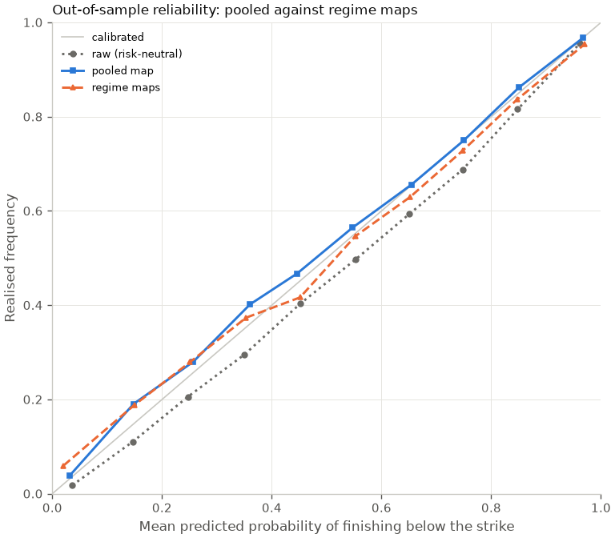

# Regime-conditional calibration: one map per regime against the pooled map

**Decision: the pooled map is used downstream.** Fitting one walk-forward calibration map per regime does not improve on the pooled map out of sample: the out-of-sample Brier score is 0.1345 with the regime maps against 0.1288 with the pooled map, a difference of +0.0057 (95% interval +0.0041 to +0.0071, 445,431 predictions on 879 expiration dates). The decision rule needs a negative difference whose interval lies below zero, so the growth lab scores every option with the pooled map of its year.

## Out of sample, overall

| Metric | Pooled | Regime | Regime minus pooled (95% CI) | Interval favours |
| --- | ---: | ---: | ---: | --- |
| Brier score | 0.1288 | 0.1345 | +0.0057 (+0.0041 to +0.0071) | pooled |
| Log loss (nats) | 0.3952 | 0.5591 | +0.1639 (+0.1079 to +0.2473) | pooled |
| ECE | 0.0160 | 0.0299 | +0.0139 (+0.0031 to +0.0214) | pooled |

Lower is better for all three metrics, so a negative difference favours the regime maps. Each interval is a 95% percentile interval from 200 cluster-bootstrap resamples of expiration dates on the paired per-prediction differences (for the ECE, the resampled clusters' bin sums).

## By regime

A regime is the 120-session IV rank bucket (`low` below 1/3, `mid`, `high` at or above 2/3) and the sign of the 20-session return (`down` at or below 0, `up` above 0). `unknown` rows (a feature missing) always use the pooled map, so their difference is zero by construction. Training rows are the predictions of that regime whose options expired before 1 January of the fold year; a regime with fewer than 50 uses the pooled map of the fold.

| Regime | Predictions | Expiries | Brier pooled | Brier regime minus pooled (95% CI) | Log loss regime minus pooled (95% CI) | ECE regime minus pooled (95% CI) | Training rows by fold | Folds on the pooled map |
| --- | ---: | ---: | ---: | ---: | ---: | ---: | ---: | ---: |
| `low_down` | 42,037 | 313 | 0.1224 | +0.0022 (-0.0008 to +0.0050) | +0.091 (+0.049 to +0.136) | +0.0188 (-0.0172 to +0.0410) | 2021: 778, 2022: 8,482, 2023: 9,561, 2024: 20,579, 2025: 24,492, 2026: 31,556 | none |
| `low_up` | 122,933 | 560 | 0.1019 | +0.0007 (+0.0002 to +0.0013) | +0.050 (+0.031 to +0.072) | +0.0105 (+0.0011 to +0.0155) | 2021: 2,653, 2022: 26,708, 2023: 31,474, 2024: 58,973, 2025: 76,987, 2026: 104,975 | none |
| `mid_down` | 55,399 | 381 | 0.1409 | +0.0145 (+0.0092 to +0.0203) | +0.399 (+0.268 to +0.573) | +0.0283 (+0.0108 to +0.0395) | 2021: 620, 2022: 4,723, 2023: 13,113, 2024: 20,402, 2025: 26,647, 2026: 37,615 | none |
| `mid_up` | 69,841 | 446 | 0.1260 | +0.0052 (+0.0026 to +0.0086) | +0.121 (+0.080 to +0.176) | +0.0096 (-0.0190 to +0.0469) | 2021: 529, 2022: 7,108, 2023: 15,592, 2024: 21,155, 2025: 35,387, 2026: 54,150 | none |
| `high_down` | 80,683 | 433 | 0.1410 | +0.0131 (+0.0086 to +0.0178) | +0.207 (+0.096 to +0.329) | +0.0332 (+0.0215 to +0.0398) | 2021: 671, 2022: 3,653, 2023: 27,554, 2024: 31,217, 2025: 39,736, 2026: 62,491 | none |
| `high_up` | 65,311 | 381 | 0.1524 | +0.0020 (-0.0012 to +0.0051) | +0.242 (+0.104 to +0.449) | -0.0162 (-0.0275 to +0.0134) | 2021: 727, 2022: 5,293, 2023: 12,657, 2024: 16,841, 2025: 33,546, 2026: 48,482 | none |
| `unknown` | 9,227 | 95 | 0.1921 | +0.0000 (+0.0000 to +0.0000) | +0.000 (+0.000 to +0.000) | +0.0000 (+0.0000 to +0.0000) | 2021: 38,036, 2022: 42,630, 2023: 45,126, 2024: 47,263, 2025: 47,263, 2026: 47,263 | 2021, 2022, 2023, 2024, 2025, 2026 |

## By days to expiry

| DTE bucket | Predictions | Expiries | Brier pooled | Brier regime | Brier regime minus pooled (95% CI) | Log loss regime minus pooled (95% CI) | ECE regime minus pooled (95% CI) |
| --- | ---: | ---: | ---: | ---: | ---: | ---: | ---: |
| <=20d | 141,452 | 862 | 0.1040 | 0.1084 | +0.0043 (+0.0031 to +0.0057) | +0.158 (+0.113 to +0.208) | +0.0053 (+0.0026 to +0.0140) |
| 21-35d | 141,677 | 497 | 0.1300 | 0.1358 | +0.0058 (+0.0043 to +0.0077) | +0.175 (+0.129 to +0.245) | +0.0120 (+0.0047 to +0.0202) |
| 36-50d | 83,513 | 218 | 0.1497 | 0.1543 | +0.0045 (+0.0020 to +0.0071) | +0.112 (+0.058 to +0.209) | +0.0144 (-0.0002 to +0.0233) |
| >50d | 78,789 | 114 | 0.1490 | 0.1582 | +0.0092 (+0.0049 to +0.0143) | +0.209 (+0.062 to +0.426) | +0.0259 (+0.0016 to +0.0354) |

## By year

| Year | Predictions | Expiries | Brier pooled | Brier regime | Brier regime minus pooled (95% CI) | Log loss regime minus pooled (95% CI) | ECE regime minus pooled (95% CI) |
| --- | ---: | ---: | ---: | ---: | ---: | ---: | ---: |
| 2021 | 55,189 | 165 | 0.1103 | 0.1209 | +0.0106 (+0.0040 to +0.0175) | +0.735 (+0.410 to +1.171) | +0.0342 (+0.0193 to +0.0483) |
| 2022 | 57,023 | 154 | 0.2010 | 0.2221 | +0.0211 (+0.0148 to +0.0265) | +0.506 (+0.360 to +0.649) | +0.0429 (+0.0381 to +0.0489) |
| 2023 | 61,525 | 132 | 0.1135 | 0.1180 | +0.0045 (+0.0021 to +0.0067) | +0.014 (+0.007 to +0.025) | +0.0035 (-0.0011 to +0.0073) |
| 2024 | 70,651 | 150 | 0.1123 | 0.1176 | +0.0052 (+0.0026 to +0.0078) | +0.028 (+0.018 to +0.039) | +0.0231 (-0.0010 to +0.0278) |
| 2025 | 107,205 | 157 | 0.1232 | 0.1245 | +0.0013 (-0.0006 to +0.0032) | +0.007 (+0.002 to +0.011) | -0.0007 (-0.0102 to +0.0117) |
| 2026 | 93,838 | 149 | 0.1247 | 0.1243 | -0.0004 (-0.0024 to +0.0010) | -0.000 (-0.005 to +0.003) | -0.0039 (-0.0101 to +0.0089) |

## Reliability

Mean predicted probability against the realised frequency in ten equal-width bins, out of sample: the raw risk-neutral probabilities, the pooled map and the regime maps. Points on the diagonal are calibrated.

## Protocol

The 492,964 predictions of `gold.calibration_prediction` (the calibration sample: the risk-neutral probability of finishing below 13 strikes from 80% to 110% of the close, per ok snapshot) were labelled with the regime of their underlying on the trade date. For every fold year the pooled map is the walk-forward map of `oap.analytics.backtest` (refitted here and checked equal to `gold.calibration_map`), and each named regime gets its own isotonic map fitted on the same training rows restricted to that regime. 36 of the 49 fold-and-regime maps were fitted; the rest use the pooled map. Both variants are scored on the same out-of-sample predictions (fold 2021 on, map not the identity), and the decision rule is fixed in advance: the regime maps are used downstream only when the overall Brier difference is negative and its 95% interval lies below zero. The study ran in 5.9s.

## Caveats

Splitting the training rows six ways leaves each regime map with a fraction of the pooled map's samples, and an isotonic fit on fewer samples has coarser steps that reach 0 or 1 more often, which the log loss punishes hardest. The regime is known only at the close of the trade date (the features use that day's close and IVs), the same time the predictions are made. The IV rank needs 120 sessions of history, so most 2020 predictions have an `unknown` regime and the 2021 regime maps are trained on few rows. Regime buckets are fixed in advance (thirds of the IV rank, the sign of the 20-session return), not tuned. The universe is today's large caps. This is a historical measurement of calibration, not trade advice.
