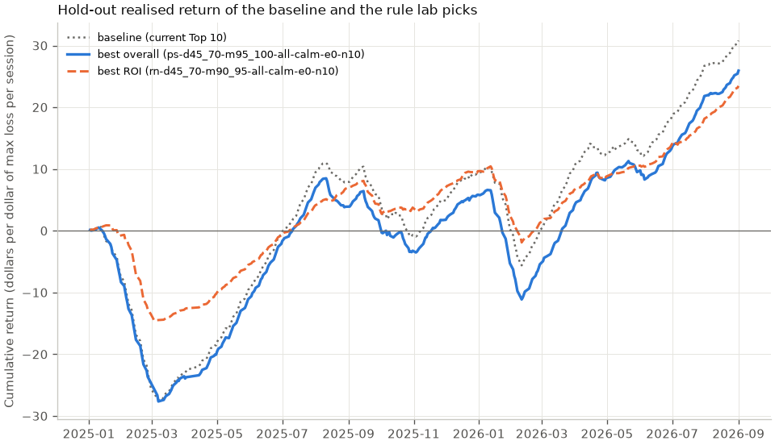

# Rule lab: put credit spread selection rules on a hold-out

1,600 candidate rules for choosing put credit spreads were run through the walk-forward backtest of the entry rule. Each was ranked on the dev years (2021-2024) and is reported on the hold-out (2025-2026), which no choice looked at. The baseline is the Top 10 rule the product uses since 2026-10-20: rank by annualised natural return with the POP shrunk halfway toward the market-implied POP; 45 to 69 days to expiry; short strike from 95% to below 100% of the close; top 10 per session, after every entry guard. The previous Top 10 rule (`rm-dany-many-all-any-e0-n10`) ranked every guarded spread by annualised return on max loss at the mid credit, at any days to expiry and moneyness.

## Headline picks (hold-out)

| Pick | Rule | Hold-out trades | Win rate | Predicted POP | Mean realised return (95% CI) | Total return on capital at risk | Sharpe per trade | Max drawdown ($1/session) | Max-loss rate |
| --- | --- | ---: | ---: | ---: | ---: | ---: | ---: | ---: | ---: |
| Baseline (current Top 10) | `ps-d45_70-m95_100-all-any-e0-n10` | 4,053 | 73.0% | 74.9% | 7.53% (-7.29% to 21.10%) | 3.02% | 0.129 | 28.11 | 18.8% |
| Previous Top 10 (until 2026-10-19) | `rm-dany-many-all-any-e0-n10` | 4,338 | 63.3% | 70.7% | -1.83% (-10.43% to 5.68%) | -2.07% | -0.027 | 26.86 | 26.9% |
| Best overall | `ps-d45_70-m95_100-all-calm-e0-n10` | 3,854 | 72.8% | 75.0% | 7.18% (-8.95% to 21.20%) | 2.69% | 0.123 | 28.17 | 18.6% |
| Best ROI | `rn-d45_70-m90_95-all-calm-e0-n10` | 3,799 | 84.4% | 83.0% | 6.04% (-6.35% to 14.93%) | 3.14% | 0.153 | 15.39 | 9.1% |

**Best overall: `ps-d45_70-m95_100-all-calm-e0-n10`.** Rank by annualised natural return with the POP shrunk halfway toward the market-implied POP; 45 to 69 days to expiry; short strike from 95% to below 100% of the close; only when the near-the-money IV rose less than 20% over 5 sessions; top 10 per session, after every entry guard. It has the highest dev Sharpe per trade of every rule with enough dev trades. On dev it made 5,335 trades with a Sharpe per trade of 0.244 and a mean realised return of 12.30% (baseline 0.236 and 12.27%). On the hold-out it made 3,854 trades, won 72.8% against a predicted 75.0%, and returned 7.18% (-8.95% to 21.20%) per trade and 2.69% on capital at risk (baseline 7.53% and 3.02%). Its hold-out interval includes zero, so a positive mean return is not established at 95% on the hold-out alone.

**Best ROI: `rn-d45_70-m90_95-all-calm-e0-n10`.** Rank by annualised calibrated return on max loss at the natural credit; 45 to 69 days to expiry; short strike from 90% to below 95% of the close; only when the near-the-money IV rose less than 20% over 5 sessions; top 10 per session, after every entry guard. It has the highest dev mean realised return among those rules whose dev drawdown is below the median of all rules (33.13). On dev it made 5,238 trades with a Sharpe per trade of 0.179 and a mean realised return of 5.76% (baseline 0.236 and 12.27%). On the hold-out it made 3,799 trades, won 84.4% against a predicted 83.0%, and returned 6.04% (-6.35% to 14.93%) per trade and 3.14% on capital at risk (baseline 7.53% and 3.02%). Its hold-out interval includes zero, so a positive mean return is not established at 95% on the hold-out alone.

Hold-out figures are per trade on max loss at the natural fill, held to expiry; the interval resamples expiration dates. Drawdowns put one dollar of maximum loss on each session, split across its trades.

## Top 10 rules on dev, with their hold-out results

Ranked by dev Sharpe per trade among the 1,600 rules with at least 400 dev trades and a finite dev drawdown; the hold-out columns are the honest numbers. Rule ids read ranking (`rm` mid return, `rn` natural return, `rr` reward to risk, `kg` Kelly growth, `ps` shrunk-POP return), DTE band (`dany` for all), short-strike moneyness band in percent (`many` for all), `one` spread per underlying and expiry or `all`, regime (`any`, `up`, `calm`, `upcalm`, `ivr`), natural edge margin in percent and spreads per session.

| # | Rule | Dev trades | Dev Sharpe | Dev mean return | Dev max drawdown | Hold-out trades | Hold-out win rate | Hold-out predicted POP | Hold-out mean return (95% CI) | Hold-out total return | Hold-out Sharpe | Hold-out max drawdown |
| --- | --- | ---: | ---: | ---: | ---: | ---: | ---: | ---: | ---: | ---: | ---: | ---: |
| 1 | `ps-d45_70-m95_100-all-calm-e0-n10` | 5,335 | 0.244 | 12.30% | 40.85 | 3,854 | 72.8% | 75.0% | 7.18% (-8.95% to 21.20%) | 2.69% | 0.123 | 28.17 |
| 2 | `ps-d45_70-m95_100-all-any-e0-n10` | 5,789 | 0.236 | 12.27% | 45.06 | 4,053 | 73.0% | 74.9% | 7.53% (-7.29% to 21.10%) | 3.02% | 0.129 | 28.11 |
| 3 | `kg-d45_70-m95_100-all-calm-e0-n10` | 5,335 | 0.233 | 11.60% | 41.26 | 3,854 | 72.4% | 74.9% | 6.76% (-9.07% to 20.43%) | 1.93% | 0.115 | 27.75 |
| 4 | `rn-d45_70-m95_100-all-calm-e0-n10` | 5,335 | 0.233 | 12.14% | 43.81 | 3,854 | 71.4% | 73.1% | 7.69% (-8.51% to 22.04%) | 4.33% | 0.128 | 28.23 |
| 5 | `rn-d45_70-m95_100-all-any-e0-n10` | 5,789 | 0.228 | 12.29% | 47.97 | 4,053 | 71.5% | 72.9% | 7.75% (-6.67% to 22.00%) | 4.83% | 0.129 | 29.04 |
| 6 | `kg-d45_70-m95_100-all-any-e0-n10` | 5,789 | 0.228 | 11.64% | 45.95 | 4,053 | 72.8% | 74.9% | 7.36% (-7.18% to 21.62%) | 3.14% | 0.126 | 27.94 |
| 7 | `rn-d45_70-many-all-calm-e0-n10` | 5,453 | 0.226 | 11.49% | 41.59 | 3,892 | 71.9% | 73.3% | 8.03% (-7.90% to 22.21%) | 4.65% | 0.135 | 27.76 |
| 8 | `rn-d45_70-many-all-any-e0-n10` | 5,826 | 0.223 | 11.83% | 47.72 | 4,071 | 71.8% | 73.1% | 8.07% (-4.02% to 22.13%) | 5.21% | 0.135 | 28.37 |
| 9 | `ps-d45_70-m95_100-all-up-e0-n10` | 4,864 | 0.213 | 10.64% | 38.14 | 3,387 | 70.3% | 75.6% | 1.95% (-17.67% to 19.13%) | -2.89% | 0.033 | 27.70 |
| 10 | `ps-d45_70-m95_100-all-upcalm-e0-n10` | 4,412 | 0.210 | 10.36% | 34.87 | 3,254 | 69.9% | 75.9% | 1.30% (-17.59% to 19.92%) | -3.30% | 0.022 | 27.35 |
| baseline | `ps-d45_70-m95_100-all-any-e0-n10` | 5,789 | 0.236 | 12.27% | 45.06 | 4,053 | 73.0% | 74.9% | 7.53% (-7.29% to 21.10%) | 3.02% | 0.129 | 28.11 |
| Previous Top 10 (until 2026-10-19) | `rm-dany-many-all-any-e0-n10` | 6,120 | -0.028 | -1.83% | 46.70 | 4,338 | 63.3% | 70.7% | -1.83% (-10.43% to 5.68%) | -2.07% | -0.027 | 26.86 |

## Multiple-comparisons check

Of 1,600 qualifying rules, 1 beat the baseline's dev Sharpe of 0.236; of those, 0 also beat its hold-out Sharpe of 0.129. The median dev rule (`kg-d7_21-m95_100-all-ivr-e10-n10`, dev Sharpe -0.026) has a hold-out Sharpe of -0.034. A rule that leads on dev and falls back on the hold-out is what searching many rules on the same data produces, so the hold-out column, not the dev ranking, is the estimate to quote.

## Protocol

Every eligible spread of every session from 2021-01-04 to 2026-10-05 was scored once by the live scoring path with the walk-forward calibration map of its year (fitted only on expirations before 1 January) and settled at expiry: 919,631 spreads, of which 567,619 pass every entry guard. Each rule chooses only among those guarded spreads: its gates (days to expiry, short-strike moneyness, regime, natural credit over fair credit), then its ranking (ties broken by the live entry rank), then at most one spread per underlying and expiry when asked, then the top 10 per session. 1,600 of the 1,600 grid rules were evaluated (25.0s). A trade belongs to the period of its trade date's year: dev is 2021-2024, the hold-out is 2025-2026. Rules are ranked on dev only, by Sharpe per trade, among those with at least 400 dev trades and a finite dev drawdown; the best ROI pick is the highest dev mean realised return among those whose dev drawdown is below the median of all rules. The hold-out was not used to choose anything. The baseline is the current Top 10 rule (`ps-d45_70-m95_100-all-any-e0-n10`), which reproduces the live `entry_top10` selection; the previous Top 10 rule (`rm-dany-many-all-any-e0-n10`) is shown next to it. Every result is in `sweep.csv` in the lab directory.

## Hold-out equity

Cumulative realised return on max loss of the hold-out trades of the baseline and the two picks, one dollar of maximum loss per session split across its trades.

## Caveats

1,600 rules were searched, so the best dev Sharpe is inflated by selection; only the hold-out figures are unbiased, and the hold-out is short (2025-2026, about 1.76 years) with overlapping positions, so its intervals are wide. A December dev trade can expire in the hold-out year, so the two periods share a few weeks of market moves. Regime features use end-of-day data of the trade date, the same close the fill is assumed at; a trader would see them only at the close. Fills are at the natural credit (short bid minus long ask) with no commissions or further slippage, and every spread is held to expiry and settled at the settlement close, with no early management or assignment. Only settled expiries are scored, so the last hold-out sessions hold short-dated spreads only and a long-DTE rule's hold-out ends weeks before the baseline's. The universe is today's large caps (hindsight in the universe biases realised losses low), and only ok snapshots are scored. This is a historical measurement of selection rules, not trade advice.
